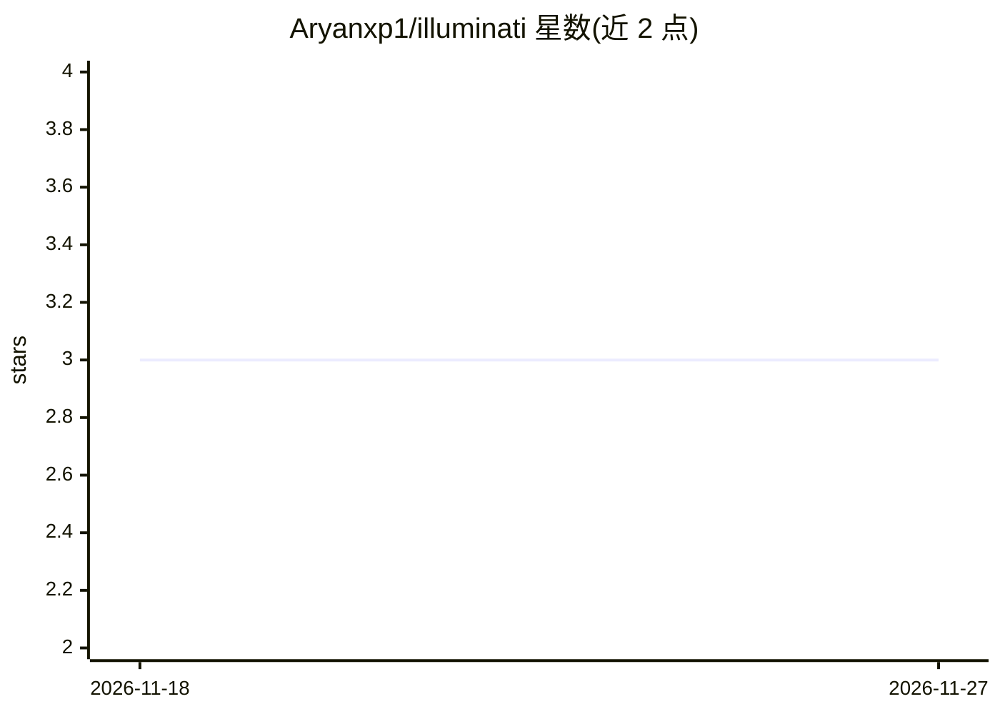

# Aryanxp1/illuminati

⭐ 3 · Python · MIT · 推送 2026-11-17 · [GitHub](https://github.com/Aryanxp1/illuminati) · [官网](https://illuminati-u2kk.onrender.com/) · 个人维护

**自主 AI Agent 的可靠性观测平台：预算治理+故障注入+评分**

面向 Geek Room AI Global Hackathon 构建的统一自主 Agent 平台与可靠性观测站，含四个引擎：三阶段模型级联与预算门控的编码 Agent、12 套混沌故障注入测试场（输出 Agent Reliability Score 数学评分）、基于 Tavily 实时搜索的知识漂移核查（StaleGuard）、会议简报 Agent；每次执行生成 SHA-256 turn receipt。提供 FastAPI Web 仪表盘、浏览器 PTY 终端与 CLI 斜杠命令，可通过 Render 在线部署或本地克隆运行。

## 筛选速览

| 维度 | 判定 | 备注 |
|---|---|---|
| AI 角色 | `ai-ecosystem` | LLM/agent 周边工具 |
| 许可风险 | `permissive` | MIT |
| 部署形态 | `desktop` | 安装包/桌面程序 |
| 模型依赖 | — | README 未给出锁定关系 |
| 硬件要求 | — | 无带数字的原话,不猜 |
| 安装摩擦 | `low` | 无编译、无系统依赖或容器化 |
| 成熟度 | — | 结构信号不足 |

## 能力要点

- 12 套混沌故障注入套件与 Agent Reliability Score（恢复率/Token 效率/延迟/安全加权）
- 3-Phase 模型级联与 $0.05/8,000 token 硬预算门控
- 每次执行生成 SHA-256 turn receipt 可验证凭据
- 浏览器 xterm.js PTY 终端连接真实 Python REPL 进程

## 适用场景

- 对自主 Agent 做故障注入韧性测试并量化可靠性评分
- 为编码 Agent 设置 Token 与成本预算上限
- 用实时网页证据核查声明的新鲜度与来源
- 在浏览器终端体验并测试平台各引擎

## 场景标签

`LLM 可观测性` `模型评测` `编码 Agent` · 领域:编码与开发

## 证据(README 行号)

> L27: Built for the **Geek Room AI Global Hackathon (November 2026)**, **Illuminati** is a unified autonomous AI agent pl
> L154: Illuminati unifies all 4 hackathon tracks into cohesive, cooperating engines sharing a central gateway and telemet

## 星数曲线

2026-11-18 3 → 2026-11-27 3（+0）

---
*卡片 v1 · prompt 1.4 · 生成 2026-11-22 · 置信度 high · 依据 README sha `0155668d4ab9` · [字段定义](../../DATASET.md)*
