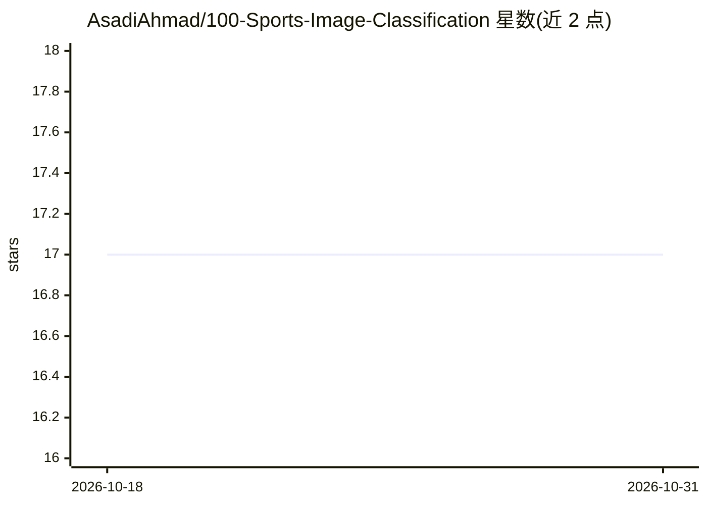

# AsadiAhmad/100-Sports-Image-Classification

⭐ 17 · Jupyter Notebook · MIT · 推送 2026-06-28 · [GitHub](https://github.com/AsadiAhmad/100-Sports-Image-Classification) · 个人维护

**基于定制 VGG19 的 100 类运动图像分类项目，含 Grad-CAM 可视化**

Jupyter Notebook 形式提供的深度学习图像分类项目：使用 torchvision 预训练 VGG19 作为骨干，冻结前 15 层特征层，替换为自定义全连接分类头（Dropout、BatchNorm、Xavier 初始化），并将首层卷积改为接受灰度输入；在 Kaggle 的 100 类运动图像数据集上做迁移学习，输入尺寸 512×512，训练 5 个 epoch，并集成 Grad-CAM 热力图用于模型可解释性。可通过 Colab 徽章一键在云端运行，训练依赖 CUDA GPU（若可用则启用）。

## 筛选速览

| 维度 | 判定 | 备注 |
|---|---|---|
| AI 角色 | `ai-native` | 本体是模型或模型工具 |
| 许可风险 | `permissive` | MIT |
| 部署形态 | `None` |  |
| 模型依赖 | — | README 未给出锁定关系 |
| 硬件要求 | — | 无带数字的原话,不猜 |
| 安装摩擦 | `medium` | 含编译或系统依赖之一 |
| 成熟度 | — | 结构信号不足 |

## 能力要点

- 定制 VGG19 迁移学习：冻结前 15 层 + 自定义分类头
- 首层卷积改为灰度输入，数据集为 100 类运动图像
- 集成 Grad-CAM 热力图做模型可解释性
- 提供 Open In Colab 徽章一键云端运行

## 适用场景

- 我想在 Colab 上复现一个运动图像分类模型
- 学习 VGG19 迁移学习与层冻结的写法
- 需要用 Grad-CAM 查看分类依据的热力图

## 场景标签

`目标检测` `教程课程` · 领域:学习与行业

## 证据(README 行号)

> L3: This project performs classification on 100 sports categories using grayscale images. The core architecture is based
> L43: |**CNN (Convolutional NN)**|`VGG19` as the base architecture|`torchvision.models`|

## 星数曲线

2026-10-18 17 → 2026-10-31 17（+0）

---
*卡片 v1 · prompt 1.4 · 生成 2026-10-30 · 置信度 high · 依据 README sha `304f6d231bd3` · [字段定义](../../DATASET.md)*
