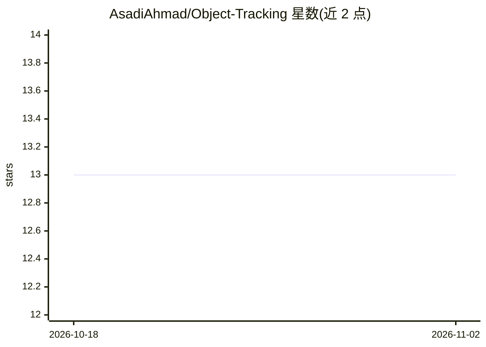

# AsadiAhmad/Object-Tracking

⭐ 13 · Jupyter Notebook · MIT · 推送 2025-12-25 · [GitHub](https://github.com/AsadiAhmad/Object-Tracking) · 个人维护

**用预训练 Mask R-CNN 检测并跟踪视频中最大物体的笔记本项目**

Jupyter Notebook/Google Colab 项目：加载预训练 Mask R-CNN 模型对视频帧做物体检测与分割，随后用 OpenCV 的 CSRT 跟踪器跟随检测到的最大物体，流程包括用 Gdown 从 Google Drive 下载预训练模型、运行检测、可视化掩膜与边界框，并导出跟踪结果视频。依赖 Python、OpenCV、NumPy、Matplotlib，通过 Colab 徽章一键运行，MIT 许可。

## 筛选速览

| 维度 | 判定 | 备注 |
|---|---|---|
| AI 角色 | `ai-native` | 本体是模型或模型工具 |
| 许可风险 | `permissive` | MIT |
| 部署形态 | `None` |  |
| 模型依赖 | — | README 未给出锁定关系 |
| 硬件要求 | — | 无带数字的原话,不猜 |
| 安装摩擦 | `low` | 无编译、无系统依赖或容器化 |
| 成熟度 | — | 结构信号不足 |

## 能力要点

- 预训练 Mask R-CNN 做视频帧物体检测与分割
- OpenCV CSRT 跟踪器跟随最大检测物体
- 可视化掩膜与边界框并导出跟踪视频

## 适用场景

- 在 Colab 上快速跑通视频物体检测与跟踪流程
- 学习 Mask R-CNN 与 CSRT 跟踪器的组合使用

## 场景标签

`目标检测` `图像视频处理` · 领域:感知与多模态

## 证据(README 行号)

> L3: This project uses a pre-trained Mask R-CNN model to detect and segment objects in video frames and then applies Open
> L9:  Google Colab&nbsp;

## 星数曲线

2026-10-18 13 → 2026-11-02 13（+0）

---
*卡片 v1 · prompt 1.4 · 生成 2026-10-31 · 置信度 high · 依据 README sha `4c5314fdaee9` · [字段定义](../../DATASET.md)*
