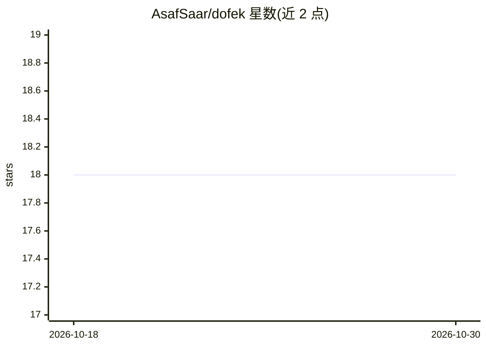

# AsafSaar/dofek

⭐ 18 · Rust · MIT · 推送 2026-10-24 · [GitHub](https://github.com/AsafSaar/dofek) · [官网](https://dofek.dev) · 个人维护

**面向本地 AI 负载的跨平台系统监视器（TUI+GUI）**

用 Rust 编写的系统监视器，同一代码库提供 Ratatui 终端界面与 Tauri 桌面 GUI，覆盖 Windows、Linux 与 Apple Silicon macOS。功能包括 CPU/GPU/内存/网络的蜡烛图与面积图、多 GPU 指标（NVML 读取每进程 VRAM）、进程管理与筛选、快照导出。AI 相关部分：按进程识别推理/加载/空闲状态并打 AI/DEV/WATCH 分类标签，提供 dofek-ollama、dofek-docker、dofek-net-ping 插件。TUI 需 truecolor 终端；macOS 的 GPU/温度面板尚未实现；Intel Mac 不支持。

## 筛选速览

| 维度 | 判定 | 备注 |
|---|---|---|
| AI 角色 | `ai-enhanced` | 去掉 AI 部分产品仍成立 |
| 许可风险 | `permissive` | MIT |
| 部署形态 | `desktop` | 安装包/桌面程序 |
| 模型依赖 | local-ok | 支持本地模型 |
| 硬件要求 | — | 无带数字的原话,不猜 |
| 安装摩擦 | `medium` | 含编译或系统依赖之一 |
| 成熟度 | — | 结构信号不足 |

## 能力要点

- 同一代码库提供 TUI 与 Tauri GUI 双界面
- AI 负载检测：每进程 VRAM、推理/加载/空闲徽标、自动分类
- 多 GPU 支持与每设备指标叠加图表
- dofek-ollama 等插件与单二进制发布（TUI 无运行时依赖）

## 适用场景

- 本地跑 ollama 时监视 VRAM 占用与模型加载状态
- 开发中查看 CPU/GPU 方差与进程资源消耗
- 按 AI/DEV/WATCH 分类筛选并批量管理进程

## 场景标签

 · 领域:系统工具/监控

## 证据(README 行号)

> L22: Most system monitors were designed before LLMs ran locally. They treat GPU as an afterthought and VRAM as a footnot
> L103: - **AI workload detection** — VRAM per-process, inference/loading/idle badges, auto-classification
> L105: - **Process watchlist with categories** — AI (●), DEV (■), WATCH (★) with color-coded rows and filter tabs

## 星数曲线

2026-10-18 18 → 2026-10-30 18（+0）

---
*卡片 v1 · prompt 1.4 · 生成 2026-10-29 · 置信度 high · 依据 README sha `06e2cde25dd4` · [字段定义](../../DATASET.md)*
