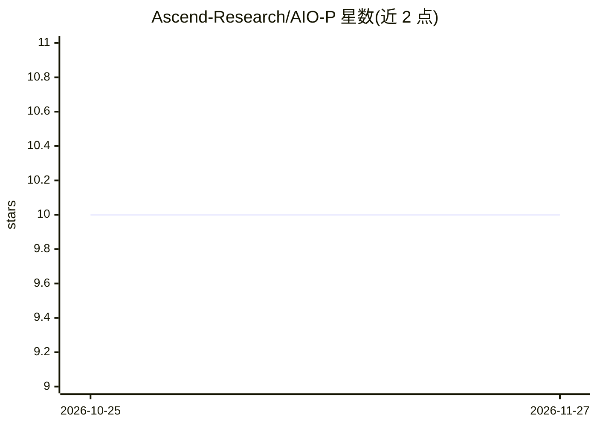

# Ascend-Research/AIO-P

⭐ 10 · Python · MIT · 推送 2026-01-12 · [GitHub](https://github.com/Ascend-Research/AIO-P) · 组织维护

**AAAI-23 论文代码库：扩展性能预测器至多视觉任务**

AAAI-23 论文 AIO-P 的官方代码仓库，将神经架构性能预测从图像分类扩展到检测、分割、人体姿态估计等任务。提供论文所用各数据集的计算图数据缓存、带标签 CG 样本与共享头伪标签的训练代码、含 k-Adapters 与标签缩放的预测器实现及基线 GNN，并提供生成/加载/可视化计算图的代码 API。安装依赖 conda 环境、TensorFlow 1.15 与 PyTorch 1.8.1，需自行下载 HuggingFace 上的缓存包及 LSP、MPII、COCO 等数据集。

## 筛选速览

| 维度 | 判定 | 备注 |
|---|---|---|
| AI 角色 | `ai-knowledge` | 知识聚合/清单类 |
| 许可风险 | `permissive` | MIT |
| 部署形态 | `desktop` | 安装包/桌面程序 |
| 模型依赖 | — | README 未给出锁定关系 |
| 硬件要求 | — | 无带数字的原话,不猜 |
| 安装摩擦 | `medium` | 含编译或系统依赖之一 |
| 成熟度 | — | 结构信号不足 |

## 能力要点

- 提供论文全部数据集的计算图（CG）数据缓存
- 含 AIO-P（k-Adapters + 标签缩放）与基线 GNN 的预测器代码
- 提供生成、加载与可视化计算图的代码 API
- 支持 Detectron2 与 HPE 两类任务的训练与性能剖析脚本

## 适用场景

- 复现 AAAI-23 论文中的性能预测实验
- 在检测/分割/姿态估计任务上训练与评测 OFA 架构族
- 获取并分析架构的计算图与 FLOPs/参数剖析结果

## 场景标签

`模型评测` `目标检测` · 领域:评测与运维

## 证据(README 行号)

> L14: Repository for the paper
> L21: Specifically, we provide the following:
> L24: - Predictor code including AIO-P with *k*-Adapters and label scaling, as well as the baseline GNN.

## 星数曲线

2026-10-25 10 → 2026-11-27 10（+0）

---
*卡片 v1 · prompt 1.4 · 生成 2026-11-20 · 置信度 high · 依据 README sha `83b9268123fa` · [字段定义](../../DATASET.md)*
