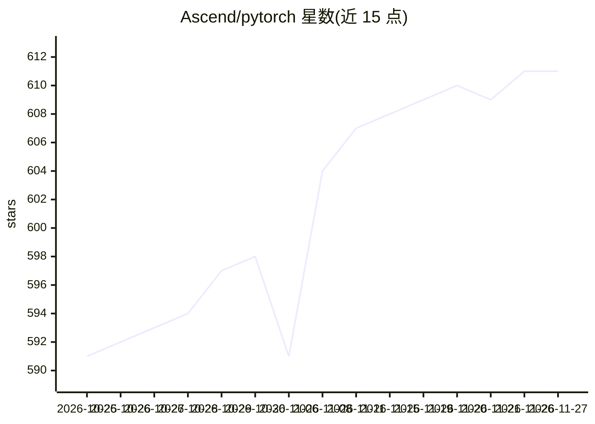

# Ascend/pytorch

⭐ 611 · Python · NOASSERTION · 推送 2026-11-26 · [GitHub](https://github.com/Ascend/pytorch) · [官网](https://www.hiascend.com/eng/developer/software/ai-frameworks/pytorch) · 组织维护 · 中文 README

**PyTorch 适配插件：让 PyTorch 直接调用华为昇腾 NPU**

TorchNPU 是 Ascend for PyTorch 社区的核心组件，一个深度学习适配插件，使 PyTorch 框架直接调用昇腾 NPU。功能覆盖基础算子、分布式训练（FSDP2、DTensor、集合通信原语）、图模式加速（v2.6.0 起支持）、profiling 调优与虚拟内存管理。支持多版本 PyTorch 单源码树适配，通过 pip 安装二进制包，也可从源码编译；运行依赖 CANN 与匹配的 NPU 驱动固件。

## 筛选速览

| 维度 | 判定 | 备注 |
|---|---|---|
| AI 角色 | `ai-ecosystem` | LLM/agent 周边工具 |
| 许可风险 | `none` | NOASSERTION |
| 部署形态 | `library` | 以包/库形式分发 |
| 模型依赖 | — | README 未给出锁定关系 |
| 硬件要求 | — | 无带数字的原话,不猜 |
| 安装摩擦 | `low` | 无编译、无系统依赖或容器化 |
| 成熟度 | — | 结构信号不足 |

## 能力要点

- 支持 FSDP2 分布式训练加速及 DTensor、AllGather/AllReduce/AllToAll 等通信原语
- 图模式通过动态图捕获+静态图优化加速训练与推理（v2.6.0+）
- 支持 profiling 分析算力、通信、内存占用，WatchDog 实时监测通信异常
- 2.5.1 起 import torch_npu 非强制（自动注册）

## 适用场景

- 在华为昇腾 NPU 上运行 PyTorch 模型训练与推理
- 将已有 PyTorch 模型迁移到昇腾硬件
- 在 NPU 上进行分布式训练与性能调优

## 场景标签

 · 领域:深度学习/硬件适配层

## 证据(README 行号)

> L29: As the core component of the Ascend for PyTorch community, **TorchNPU** is a deep learning adapter plugin developed
> L3:  PyTorch Adapter Plugin for Ascend NPU

## 星数曲线

2026-10-25 591 → 2026-11-27 611（+20）

---
*卡片 v1 · prompt 1.4 · 生成 2026-11-25 · 置信度 high · 依据 README sha `ec1797d6e768` · [字段定义](../../DATASET.md)*
