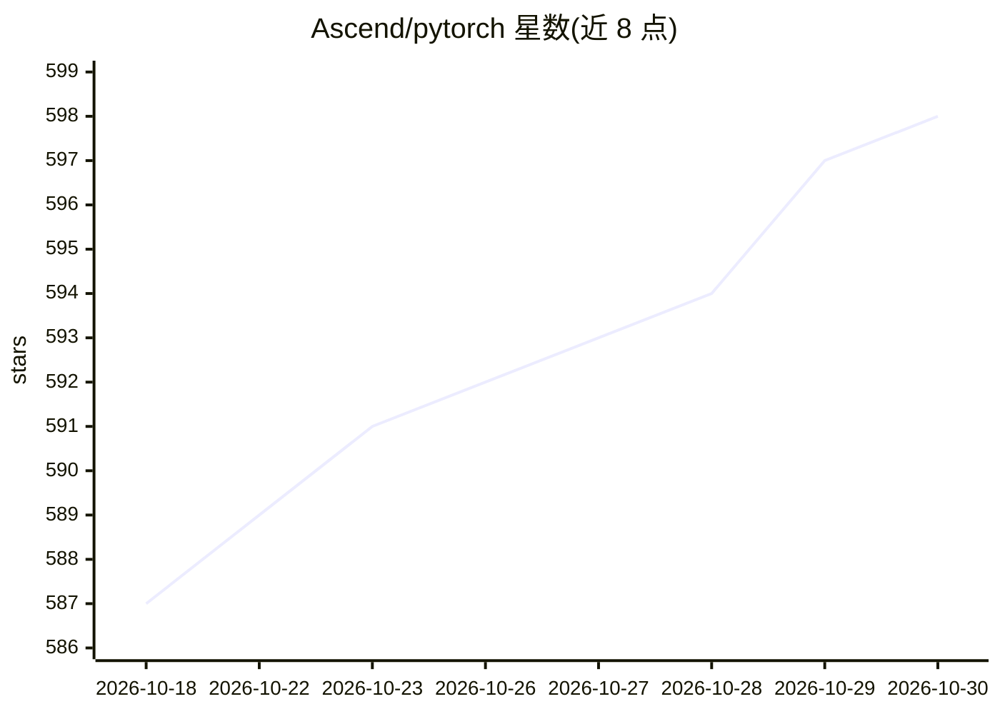

# Ascend/pytorch

⭐ 598 · Python · NOASSERTION · 推送 2026-10-29 · [GitHub](https://github.com/Ascend/pytorch) · [官网](https://www.hiascend.com/eng/developer/software/ai-frameworks/pytorch) · 组织维护 · 中文 README

**让 PyTorch 直接调用昇腾 NPU 的适配插件**

华为昇腾社区维护的 PyTorch 深度学习适配插件 torch_npu，通过 PrivateUse1 机制将昇腾 NPU 的算子与设备资源接入 PyTorch 框架，使开发者可在 NPU 上复用 PyTorch 原生 API 进行训练与推理。支持分布式训练（FSDP2、DTensor、集合通信原语）、图模式加速（v2.6.0+）、profiling 调优与虚拟内存管理。二进制安装依赖 CANN、NPU 驱动与对应版本 PyTorch，版本兼容矩阵以 version.txt 为准，也可从源码编译。

## 筛选速览

| 维度 | 判定 | 备注 |
|---|---|---|
| AI 角色 | `ai-ecosystem` | LLM/agent 周边工具 |
| 许可风险 | `none` | NOASSERTION |
| 部署形态 | `library` | 以包/库形式分发 |
| 模型依赖 | — | README 未给出锁定关系 |
| 硬件要求 | — | 无带数字的原话,不猜 |
| 安装摩擦 | `low` | 无编译、无系统依赖或容器化 |
| 成熟度 | — | 结构信号不足 |

## 能力要点

- 通过 PrivateUse1 将 Ascend NPU 算子与设备接入 PyTorch
- 分布式支持 FSDP2、DTensor 与集合通信原语
- 图模式（动态图捕获+静态图优化）与 NPUGraph 卸载执行
- 支持计算/通信/内存 profiling 与 WatchDog 通信异常监控

## 适用场景

- 把已有 PyTorch 训练与推理代码迁移到昇腾 NPU
- 在昇腾硬件上进行分布式大模型训练
- 对 NPU 上的计算、通信与内存做性能分析调优

## 场景标签

`模型训练` · 领域:训练与推理

## 证据(README 行号)

> L29: As the core component of the Ascend for PyTorch community, **TorchNPU** is a deep learning adapter plugin built by 
> L45: - **TorchNPU Core:** Supports virtual memory management to reduce memory fragmentation, cross-stream memory reuse o

## 星数曲线

2026-10-18 587 → 2026-10-30 598（+11）

---
*卡片 v1 · prompt 1.4 · 生成 2026-10-21 · 置信度 high · 依据 README sha `3afb5ef4551b` · [字段定义](../../DATASET.md)*
