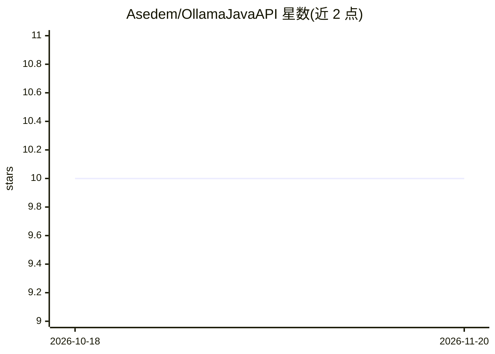

# Asedem/OllamaJavaAPI

⭐ 10 · Java · MIT · 推送 2026-08-19 · [GitHub](https://github.com/Asedem/OllamaJavaAPI) · 个人维护

**面向 Java 开发者的 Ollama API 绑定库**

Ollama API 的 Java 客户端绑定库，封装 Ollama 的补全生成、对话、本地/运行中模型列表、模型信息查看、模型创建/复制/删除/拉取/推送、嵌入生成与服务器版本查询等操作，并支持自定义服务地址与端口连接（默认 localhost:11434）。通过 Maven 或 Gradle 依赖引入，README 说明功能尚未完成、流式输出与进度反馈尚未实现。

## 筛选速览

| 维度 | 判定 | 备注 |
|---|---|---|
| AI 角色 | `ai-ecosystem` | LLM/agent 周边工具 |
| 许可风险 | `permissive` | MIT |
| 部署形态 | `None` |  |
| 模型依赖 | local-ok | 支持本地模型 |
| 硬件要求 | — | 无带数字的原话,不猜 |
| 安装摩擦 | `low` | 无编译、无系统依赖或容器化 |
| 成熟度 | `idea` | |

## 能力要点

- 封装 Ollama 全部主要 API 操作：补全、对话、嵌入与模型管理
- Maven/Gradle 依赖方式引入（jitpack 仓库）
- 支持自定义 Ollama 服务地址与端口
- README 标注流式响应与进度反馈尚未实现

## 适用场景

- 在 Java 应用中调用本地 Ollama 模型做补全与对话
- 用 Java 代码管理 Ollama 模型的创建、拉取、复制与删除
- 在 Java 项目中生成文本嵌入向量

## 场景标签

`模型网关` · 领域:Agent 开发

## 证据(README 行号)

> L5: OllamaJavaAPI is a Java binding for the Ollama API, making
> L12: - Intuitive API client: Set up and interact with Ollama in just a few lines of code. `✓`

## 星数曲线

2026-10-18 10 → 2026-11-20 10（+0）

---
*卡片 v1 · prompt 1.4 · 生成 2026-11-20 · 置信度 high · 依据 README sha `a22e0de7c458` · [字段定义](../../DATASET.md)*
