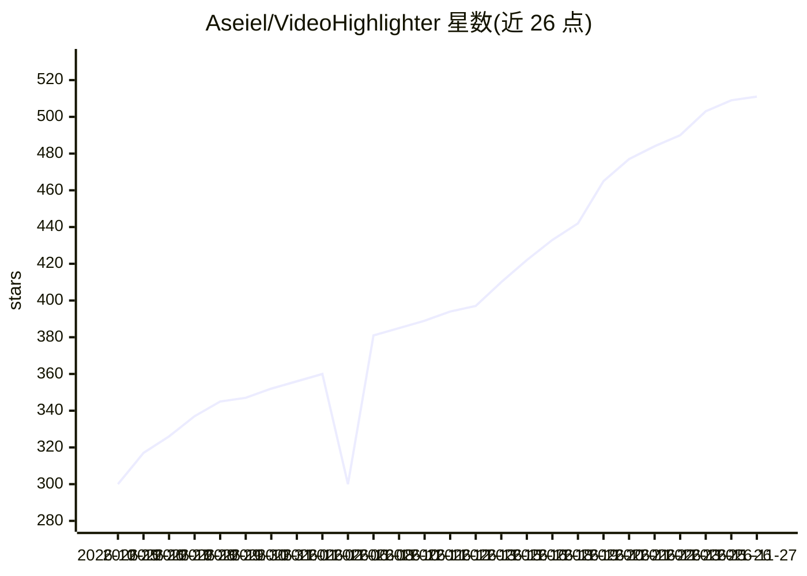

# Aseiel/VideoHighlighter

⭐ 511 · Python · AGPL-3.0 · 推送 2026-11-24 · [GitHub](https://github.com/Aseiel/VideoHighlighter) · 组织维护 · 中文 README

**本地 AI 视频分析桌面应用：高光剪辑与检索不外传**

本地运行的桌面应用：放入原始视频后，综合场景、运动、音频、物体、动作与转写文本对片段打分，在信号时间线和报告中展示每段得分原因，并导出高光集锦与单独片段；分析过程不上传数据，基础流程无需 API key。支持组合规则自定义事件、CLIP 搜索、模型训练与社区模型分发。提供 Windows/macOS/Linux 安装包，另有付费 Pro 版提供实时叠加、开放词汇检测等实时功能；AGPL-3.0 许可。

## 筛选速览

| 维度 | 判定 | 备注 |
|---|---|---|
| AI 角色 | `ai-native` | 本体是模型或模型工具 |
| 许可风险 | `viral` | AGPL-3.0 |
| 部署形态 | `desktop` | 安装包/桌面程序 |
| 模型依赖 | local-ok | 支持本地模型 |
| 硬件要求 | — | 无带数字的原话,不猜 |
| 安装摩擦 | `medium` | 含编译或系统依赖之一 |
| 成熟度 | — | 结构信号不足 |

## 能力要点

- 多信号打分并输出可解释报告：逐项列出各信号得分与转写来源声明
- 组合规则引擎：将检测组合定义为命名事件，重跑开销毫秒级
- Auto 流水线：读卡→导入→剪辑→配乐→成片，可断点续跑
- 本地 Whisper 转写、章节与字幕生成，支持远程 Ollama

## 适用场景

- 把几小时直播 VOD 或 GoPro 素材剪成几分钟高光
- 本地筛查监控/野外相机 footage 中有物体移动的片段
- 为访谈、课程、播客生成分章与字幕
- 行车记录仪审查后产出可交出的测量依据报告

## 场景标签

`语音识别` `目标检测` `语义搜索` `图像视频处理` · 领域:知识与检索

## 证据(README 行号)

> L11: A local desktop app. Drop in raw video; it scores strong moments from scene,
> L14: the individual clips. Nothing is uploaded for analysis, and the basic pipeline
> L112: **VideoHighlighter — this repository — is free software under AGPL-3.0, and

## 星数曲线

2026-10-25 300 → 2026-11-27 511（+211）

---
*卡片 v1 · prompt 1.4 · 生成 2026-11-25 · 置信度 high · 依据 README sha `bfca43234771` · [字段定义](../../DATASET.md)*
