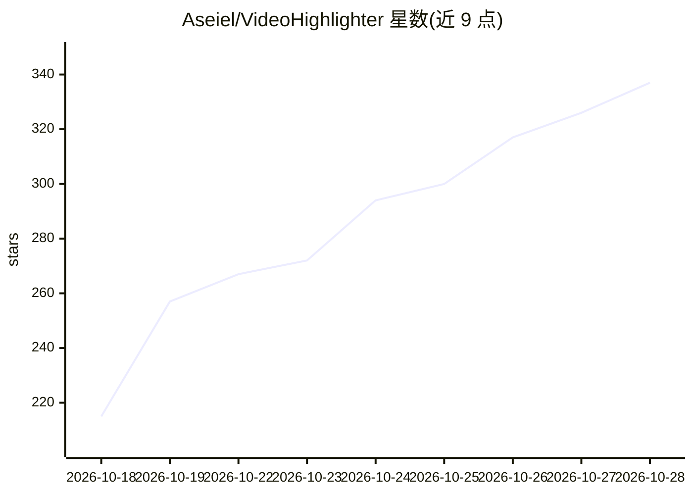

# Aseiel/VideoHighlighter

⭐ 337 · Python · AGPL-3.0 · 推送 2026-10-25 · [GitHub](https://github.com/Aseiel/VideoHighlighter) · 个人维护

**本地离线 AI 视频分析桌面应用：检测/高光/字幕一体**

在本地运行的桌面应用：读入原始视频，综合场景、运动、音频、物体、动作与转写文本对片段打分，生成信号时间线与解释性报告，导出高光集锦与单片段；支持本地 Whisper 转写与章节字幕、CLIP 视觉搜索、组合规则定义事件、自标注训练模型与社区模型。基础流水线无需 API key，分析不上传。面向 Windows/macOS/Linux，支持 Intel/AMD/NVIDIA GPU。另有付费 Pro 版增加实时叠加等能力。

## 筛选速览

| 维度 | 判定 | 备注 |
|---|---|---|
| AI 角色 | `ai-native` | 本体是模型或模型工具 |
| 许可风险 | `viral` | AGPL-3.0 |
| 部署形态 | `desktop` | 安装包/桌面程序 |
| 模型依赖 | local-ok | 支持本地模型 |
| 硬件要求 | — | 无带数字的原话,不猜 |
| 安装摩擦 | `medium` | 含编译或系统依赖之一 |
| 成熟度 | — | 结构信号不足 |

## 能力要点

- 多信号（场景/运动/音频/物体/动作/转写）打分并解释每个保留片段
- 本地 Whisper 转写与章节/字幕生成、CLIP 视觉搜索
- 组合规则：按检测组合（如球进网）定义命名事件，重跑仅需毫秒级
- 自训练模型（一个框标注即可）与社区模型分发

## 适用场景

- 把几小时直播 VOD 或监控录像剪成几分钟高光
- 长访谈/讲座自动生成章节与本地字幕
- 行车记录仪 footage 本地分析并产出可交接的报告
- SD 卡素材一键 ingest、剪辑、配乐成片

## 场景标签

`语义搜索` `语音识别` `目标检测` `图像视频处理` · 领域:知识与检索

## 证据(README 行号)

> L11: A local desktop app. Drop in raw video; it scores strong moments from scene,
> L43: - **A long interview, lecture or podcast → chapters and subtitles.** Local

## 星数曲线

2026-10-18 215 → 2026-10-28 337（+122）

---
*卡片 v1 · prompt 1.4 · 生成 2026-10-22 · 置信度 mid · 依据 README sha `a2b0f49bf8b5` · [字段定义](../../DATASET.md)*
