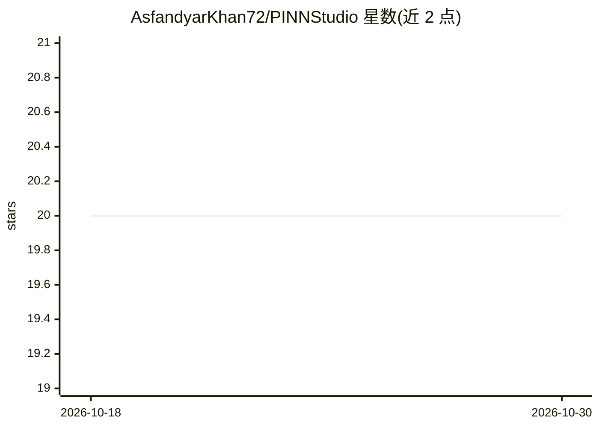

# AsfandyarKhan72/PINNStudio

⭐ 20 · Python · MIT · 推送 2026-10-29 · [GitHub](https://github.com/AsfandyarKhan72/PINNStudio) · 个人维护

**无代码的物理信息神经网络科学计算环境：求解正/逆问题**

面向科研与工程研究者的桌面应用（PyQt6），通过图形界面定义方程、计算域、边界/初始条件与训练设置，训练物理信息神经网络（PINN）求解 1D–3D 的 ODE/PDE 正问题与逆问题。训练支持多阶段（Adam→L-BFGS）、残差自适应加点、时间推进等自适应方法，输出误差分析、图表动画、可导出的解数据及可复现的独立 Python 脚本。内置 65 个示例（含 Navier–Stokes 与 DeepXDE 基准），基于 DeepXDE/PyTorch 后端，GPU 可选。

## 筛选速览

| 维度 | 判定 | 备注 |
|---|---|---|
| AI 角色 | `ai-native` | 本体是模型或模型工具 |
| 许可风险 | `permissive` | MIT |
| 部署形态 | `desktop` | 安装包/桌面程序 |
| 模型依赖 | — | README 未给出锁定关系 |
| 硬件要求 | — | 无带数字的原话,不猜 |
| 安装摩擦 | `medium` | 含编译或系统依赖之一 |
| 成熟度 | — | 结构信号不足 |

## 能力要点

- 无代码定义方程/计算域/条件并训练 PINN，求解正逆问题
- 多阶段训练与自适应方法（RAR、时间推进、RBA/SA-PINN 加权、因果训练）
- 65 个内置示例，63 个带精确解或参考数据可对比
- 每个问题生成可独立复现的 Python 脚本；参数扫描与运行历史对比

## 适用场景

- 不写脚本即可用 PINN 求解自己的微分方程问题
- 从测量数据反演未知系数或未知场（逆问题）
- 对比多种训练策略与参数设置下的解误差
- 教学场景中演示 PINN 求解过程与结果

## 场景标签

`科研工具` · 领域:学习与行业

## 证据(README 行号)

> L37: **PINNStudio** is a scientific computing environment for solving differential equations with physics-informed neura
> L39: Setting up a PINN by hand means writing a new script for every problem: the residual of the equations through autom

## 星数曲线

2026-10-18 20 → 2026-10-30 20（+0）

---
*卡片 v1 · prompt 1.4 · 生成 2026-10-28 · 置信度 high · 依据 README sha `4a0f06ab7e32` · [字段定义](../../DATASET.md)*
