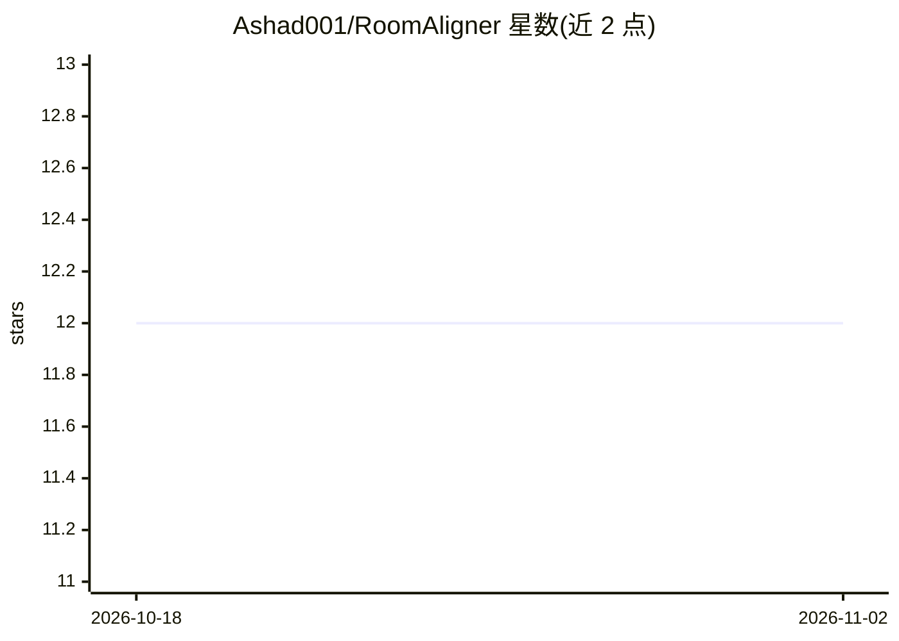

# Ashad001/RoomAligner

⭐ 12 · Python · 推送 2026-08-12 · [GitHub](https://github.com/Ashad001/RoomAligner) · 个人维护

**分析户型图并给出家具布局优化建议的 AI 室内设计助手**

面向普通用户的室内设计助手应用：上传 .jpg 户型图或房间图片后，系统通过 Roboflow 推理客户端检测图中家具与固定物件，生成房间的自然语言描述，再基于房间结构给出家具重排与空间利用的优化建议。以 Streamlit 网页应用形式运行，同时提供部署在 Hugging Face Space 上的 HTTP API（文件上传与 URL 上传两种端点，返回描述、当前结构与建议），可通过 iframe 嵌入网页，API 已开启 CORS。运行需要配置 Roboflow 与 Groq 的 API key。

## 筛选速览

| 维度 | 判定 | 备注 |
|---|---|---|
| AI 角色 | `ai-native` | 本体是模型或模型工具 |
| 许可风险 | `none` | — |
| 部署形态 | `library` | 以包/库形式分发 |
| 模型依赖 | locked-api |  |
| 硬件要求 | — | 无带数字的原话,不猜 |
| 安装摩擦 | `low` | 无编译、无系统依赖或容器化 |
| 成熟度 | — | 结构信号不足 |

## 能力要点

- 从户型图自动检测家具等对象并生成自然语言房间描述
- 基于房间结构生成家具重排与空间利用建议
- 提供 Streamlit 界面与 Hugging Face Space 托管的 HTTP API（文件/URL 两种上传端点）
- API 支持 CORS，可通过 iframe 嵌入网页

## 适用场景

- 上传我的户型图，看看家具怎么摆更合理
- 获得房间布局的自然语言描述和优化建议
- 把布局建议功能嵌入自己的网页应用

## 场景标签

`多模态` · 领域:感知与多模态

## 证据(README 行号)

> L3: RoomAligner is an AI-powered interior design assistant that helps users optimize room layouts for better flow and sp
> L13: 2. **AI-Powered Object Detection**: RoomAligner detects and classifies objects in the image using a powerful infere

## 星数曲线

2026-10-18 12 → 2026-11-02 12（+0）

---
*卡片 v1 · prompt 1.4 · 生成 2026-11-01 · 置信度 mid · 依据 README sha `4e76ebde43b8` · [字段定义](../../DATASET.md)*
