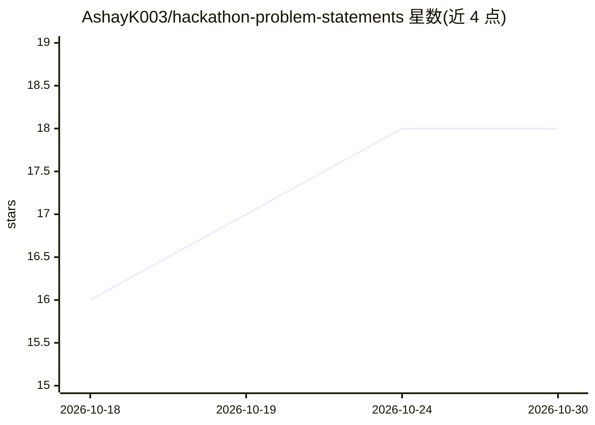

# AshayK003/hackathon-problem-statements

⭐ 18 · MIT · 推送 2026-09-08 · [GitHub](https://github.com/AshayK003/hackathon-problem-statements) · 个人维护

**面向黑客松与课程项目的真实问题清单（65 题，5 赛道）**

策展型问题陈述仓库：收录 65 个按 5 条赛道（Global South、US Civic Tech、India Impact、Frontier AI、Rapid Prototypes）组织的题目，每个条目标注影响数据、构建时长、标签，并链接数据集与研究论文。面向黑客松参赛者、高校学生（minor/major/capstone）、作品集构建者、组织者与 NGO，提供按学术场景选题的框架、检查清单与作品集策略表。仓库本身不含代码，接受通过模板贡献新题目。

## 筛选速览

| 维度 | 判定 | 备注 |
|---|---|---|
| AI 角色 | `ai-knowledge` | 知识聚合/清单类 |
| 许可风险 | `permissive` | MIT |
| 部署形态 | `None` |  |
| 模型依赖 | — | README 未给出锁定关系 |
| 硬件要求 | — | 无带数字的原话,不猜 |
| 安装摩擦 | `low` | 无编译、无系统依赖或容器化 |
| 成熟度 | — | 结构信号不足 |

## 能力要点

- 65 个问题按 5 条赛道组织，标注影响数据与构建时长
- 每个问题链接数据集与研究论文
- 提供按学术场景（minor/major/capstone）选题的框架与检查清单
- 提供 _PROBLEM_TEMPLATE.md 的 15 分钟贡献路径

## 适用场景

- 黑客松选手快速选取有数据支撑的题目
- 高校学生按学期时长选择 minor/major/capstone 项目
- 组织者为赛事投放结构化问题陈述

## 场景标签

`精选清单` · 领域:学习与行业

## 证据(README 行号)

> L5: This is the largest curated collection of **real-world problem statements** (65 problems across 5 tracks) — built fo
> L38: - ✅ **Real** — Grounded in actual data sources, government datasets, published research, and quantified stakeholder

## 星数曲线

2026-10-18 16 → 2026-10-30 18（+2）

---
*卡片 v1 · prompt 1.4 · 生成 2026-10-29 · 置信度 high · 依据 README sha `9676ebf1d533` · [字段定义](../../DATASET.md)*
