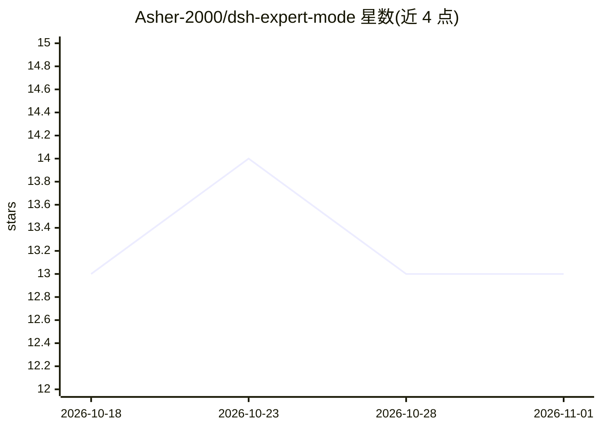

# Asher-2000/dsh-expert-mode

⭐ 13 · JavaScript · MIT · 推送 2026-09-07 · [GitHub](https://github.com/Asher-2000/dsh-expert-mode) · 个人维护 · 中文 README

**DeepSeek Harness 的专家模式预设：1 协调官 + 17 领域专家子代理**

面向 DeepSeek Harness（DSH）的 agent-preset 插件：安装并挂载到 DSH 预设目录后，DSH 进入由首席协调官与 17 位领域专家（前端/后端/数据库/安全/法务/金融等）组成的多智能体模式。协调官识别任务领域并分派专家，简单任务直接处理；提供文件消息总线（bus.py）、文件系统任务调度器（taskboard.py）、5 阶段质量门与经验池等机制。通过 dsh plugin add 或 npm 安装，也可从 GitHub 克隆源码手动安装；跨会话记忆需另行安装 dsh-memory-connect 到宿主层。

## 筛选速览

| 维度 | 判定 | 备注 |
|---|---|---|
| AI 角色 | `ai-ecosystem` | LLM/agent 周边工具 |
| 许可风险 | `permissive` | MIT |
| 部署形态 | `library` | 以包/库形式分发 |
| 模型依赖 | locked-api |  |
| 硬件要求 | — | 无带数字的原话,不猜 |
| 安装摩擦 | `low` | 无编译、无系统依赖或容器化 |
| 成熟度 | — | 结构信号不足 |

## 能力要点

- 1 协调官 + 17 位领域专家子代理，按领域自动分派
- 文件消息总线（bus.py）支持中继/并行/广播/评审/P2P 五种通信模式
- 文件系统任务调度器：状态机、依赖 DAG、重试与崩溃恢复
- 中英双语文档

## 适用场景

- 让 DSH 以多专家团队方式处理全栈开发任务
- 复杂任务并行调度多个专家子代理
- 高任务走 5 阶段质量门与多专家交叉评审

## 场景标签

`多智能体` `编码 Agent` · 领域:Agent 开发

## 证据(README 行号)

> L23: Install this preset and DSH automatically becomes a "Chief Coordinator" mode:

## 星数曲线

2026-10-18 13 → 2026-11-01 13（+0）

---
*卡片 v1 · prompt 1.4 · 生成 2026-10-31 · 置信度 high · 依据 README sha `bf98fe0c8861` · [字段定义](../../DATASET.md)*
