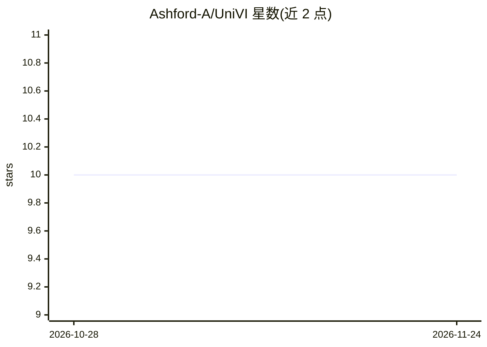

# Ashford-A/UniVI

⭐ 11 · Jupyter Notebook · MIT · 推送 2026-11-18 · [GitHub](https://github.com/Ashford-A/UniVI) · [官网](https://univi.readthedocs.io) · 组织维护

**单细胞多模态 VAE 工具包：将异构单细胞数据对齐到共享潜空间**

UniVI 是面向单细胞组学的多模态变分自编码器 Python 工具包，每种模态配备独立编码器与解码器，将 RNA、表面蛋白、染色质可及性、DNA 甲基化等数据整合到同一潜空间。支持的典型任务包括跨模态整合、由一个模态预测另一个模态、把单模态新数据映射到多模态参考图谱、细胞生成与去噪。通过 PyPI 与 conda-forge 分发，快速上手依赖 PyTorch（可按需选择 CUDA 构建）；配套 readthedocs 文档、Google Colab 教程，并附论文图表的复现笔记本与 conda 环境文件。

## 筛选速览

| 维度 | 判定 | 备注 |
|---|---|---|
| AI 角色 | `ai-native` | 本体是模型或模型工具 |
| 许可风险 | `permissive` | MIT |
| 部署形态 | `library` | 以包/库形式分发 |
| 模型依赖 | — | README 未给出锁定关系 |
| 硬件要求 | — | 无带数字的原话,不猜 |
| 安装摩擦 | `medium` | 含编译或系统依赖之一 |
| 成熟度 | — | 结构信号不足 |

## 能力要点

- 每模态独立编码器/解码器，支持单、双、三模态及更多整合
- 跨模态预测、query mapping 转移标签、细胞生成与去噪
- 提供三种似然（计数、beta-binomial 甲基化等）的自定义模态机制
- 附 Genome Research 论文全部图表的复现笔记本与驱动脚本

## 适用场景

- 把配对的 RNA+ATAC（如 10x Multiome）整合到一个潜空间并对齐细胞
- 对仅有 RNA 的数据做标注转移并标记陌生细胞
- 对参考模型加细胞类型/基因型头部做精调
- 生成合成细胞或做 in-silico 扰动分析

## 场景标签

`多模态` `科研工具` · 领域:学习与行业

## 证据(README 行号)

> L20: **UniVI** integrates single-cell modalities measured in the same cells (RNA, surface protein, chromatin accessibili
> L72: > Ashford AJ, Enright T, Somers J, Nikolova O, Demir E. Unifying multimodal single-cell data with a mixture-of-expe

## 星数曲线

2026-10-28 10 → 2026-11-24 10（+0）

---
*卡片 v1 · prompt 1.4 · 生成 2026-11-20 · 置信度 high · 依据 README sha `b191a940e822` · [字段定义](../../DATASET.md)*
