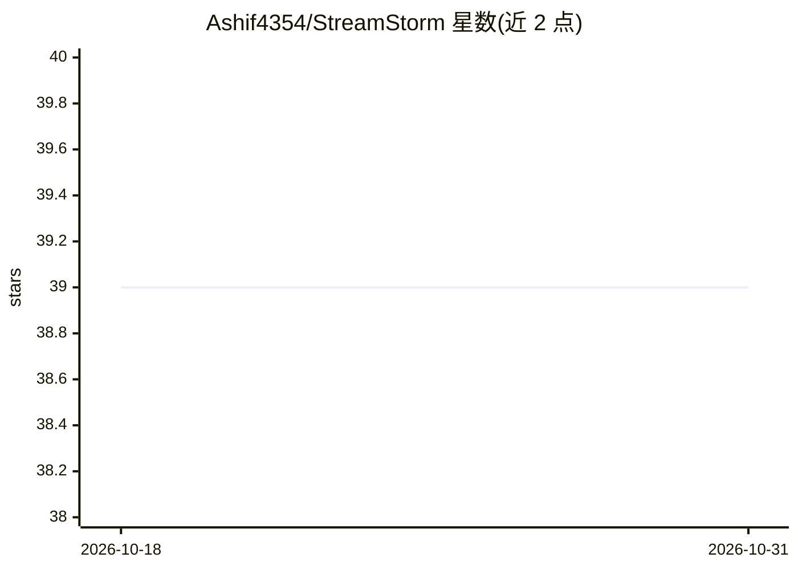

# Ashif4354/StreamStorm

⭐ 39 · JavaScript · NOASSERTION · 推送 2026-10-25 · [GitHub](https://github.com/Ashif4354/StreamStorm) · [官网](https://streamstorm.darkglance.in) · 个人维护

**YouTube 直播聊天群发自动化桌面应用，带 AI 生成与 MCP 服务**

基于浏览器自动化的桌面应用：通过多浏览器实例、Cookie 登录与隔离账号配置，向多个 YouTube 直播聊天按间隔批量发送消息，支持调度、暂停/恢复与实例级控制。内置 FastAPI 后端、React 实时仪表盘（消息速率、日志、CPU/RAM 监控），并集成 FastMCP 服务（localhost:1919/mcp）供外部 LLM 客户端以自然语言控制。AI 功能包括消息/频道名生成（OpenAI、Anthropic、Gemini 及自定义提供商）。README 自述『专为滥用设计、不遵守任何条款』；许可为 Personal Use License。源码运行需 Node.js v20.17+ 与 uv。

## 筛选速览

| 维度 | 判定 | 备注 |
|---|---|---|
| AI 角色 | `ai-enhanced` | 去掉 AI 部分产品仍成立 |
| 许可风险 | `none` | NOASSERTION |
| 部署形态 | `library` | 以包/库形式分发 |
| 模型依赖 | locked-api |  |
| 硬件要求 | — | 无带数字的原话,不猜 |
| 安装摩擦 | `low` | 无编译、无系统依赖或容器化 |
| 成熟度 | — | 结构信号不足 |

## 能力要点

- 多浏览器实例与 Cookie 登录实现多账号隔离群发
- FastMCP 服务暴露风暴启停/配置/监控工具供外部 LLM 客户端调用
- AI 消息与频道名生成，支持 OpenAI/Anthropic/Gemini 及自定义提供商
- React 实时仪表盘展示消息速率、日志与 CPU/RAM 指标

## 适用场景

- 向多个 YouTube 直播聊天批量定时发送消息
- 通过 MCP 让 AI 助手用自然语言控制群发会话
- 管理多个 YouTube 账号并监控群发会话状态

## 场景标签

`浏览器自动化` `AI 写作` · 领域:效率与自动化

## 证据(README 行号)

> L3: StreamStorm is a lightweight desktop application built specifically to automate mass messaging (aka spamming) in You
> L24:  * AI-powered message generation — Generate YouTube comments using AI with customizable prompts.
> L29: * **MCP (Model Context Protocol) Server**: Full MCP server integration with FastMCP framework, accessible at `local

## 星数曲线

2026-10-18 39 → 2026-10-31 39（+0）

---
*卡片 v1 · prompt 1.4 · 生成 2026-10-25 · 置信度 mid · 依据 README sha `c9bdb88c42f6` · [字段定义](../../DATASET.md)*
