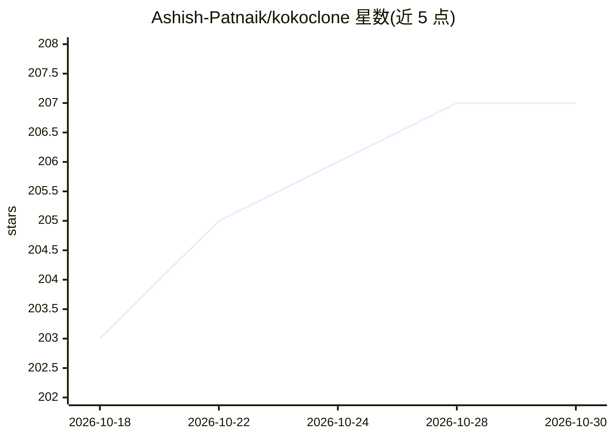

# Ashish-Patnaik/kokoclone

⭐ 207 · Python · Apache-2.0 · 推送 2026-04-19 · [GitHub](https://github.com/Ashish-Patnaik/kokoclone) · [官网](https://huggingface.co/spaces/PatnaikAshish/kokoclone) · 个人维护

**基于 Kokoro-ONNX 的多语言零样本语音克隆与变声系统**

构建在 Kokoro-ONNX 之上的语音克隆系统：支持 8 种语言的文本转语音，上传 3–10 秒参考音频即可零样本克隆该声音；另提供音频到音频的变声模式，走 Kanade 变声模型，配合 VRAM 感知分块处理任意长度录音。首次运行自动从 Hugging Face 下载模型权重，检测硬件后在 CPU 或 GPU 上运行。提供 Gradio Web 界面、CLI 和 Python API 三种使用方式，通过 Conda/uv 安装。

## 筛选速览

| 维度 | 判定 | 备注 |
|---|---|---|
| AI 角色 | `ai-native` | 本体是模型或模型工具 |
| 许可风险 | `permissive` | Apache-2.0 |
| 部署形态 | `library` | 以包/库形式分发 |
| 模型依赖 | — | README 未给出锁定关系 |
| 硬件要求 | — | 无带数字的原话,不猜 |
| 安装摩擦 | `medium` | 含编译或系统依赖之一 |
| 成熟度 | — | 结构信号不足 |

## 能力要点

- 8 种语言的零样本语音克隆（3–10 秒参考音频）
- 音频到音频变声：Kanade 模型，VRAM 感知自动分块处理长录音
- 模型权重首次运行自动从 Hugging Face 下载
- Gradio Web UI / CLI / Python API 三种使用途径

## 适用场景

- 输入文本并上传参考音频，生成克隆声音的多语言语音
- 把已有录音变声为参考说话人的声音
- 通过 Python API 把语音克隆集成到自己的应用

## 场景标签

`语音合成` · 领域:内容生成

## 证据(README 行号)

> L16: **KokoClone** is a fast, real-time compatible multilingual voice cloning system built on top of **Kokoro-ONNX**, on
> L19: * **Text → Clone:** Type text in multiple languages, provide a short reference audio clip, and instantly generate s

## 星数曲线

2026-10-18 203 → 2026-10-30 207（+4）

---
*卡片 v1 · prompt 1.4 · 生成 2026-10-22 · 置信度 high · 依据 README sha `37a4e097dcb5` · [字段定义](../../DATASET.md)*
