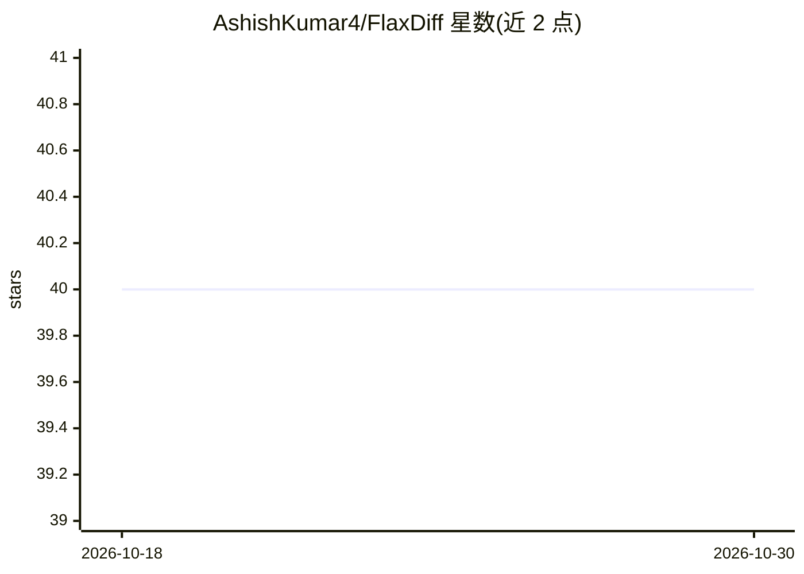

# AshishKumar4/FlaxDiff

⭐ 40 · Jupyter Notebook · 推送 2026-10-28 · [GitHub](https://github.com/AshishKumar4/FlaxDiff) · 个人维护

**面向学习与实验的 Flax/Jax 扩散模型库，附从零教程**

基于 Flax/Jax 的扩散模型工具库，提供调度器（DDPM/EDM/FlowMatching 等 9 种）、预测变换、采样器（DDPM/DDIM/Euler/Heun/RK4 等）、UNet/DiT 系列模型、VAE 潜空间扩散与 I-JEPA/V-JEPA 训练目标，统一由 GeneralDiffusionTrainer 以数据并行与 FSDP 分片运行，覆盖图像与视频扩散及流匹配。设计取向为可读性优先于性能，作者以个人学习项目起步，附从零实现且独立于库的教程 notebook。pip 安装，要求 Python 3.11+，较大的模型在 TPU-v4-32 pod 上训练。

## 筛选速览

| 维度 | 判定 | 备注 |
|---|---|---|
| AI 角色 | `ai-native` | 本体是模型或模型工具 |
| 许可风险 | `none` | — |
| 部署形态 | `library` | 以包/库形式分发 |
| 模型依赖 | — | README 未给出锁定关系 |
| 硬件要求 | — | 无带数字的原话,不猜 |
| 安装摩擦 | `low` | 无编译、无系统依赖或容器化 |
| 成熟度 | — | 结构信号不足 |

## 能力要点

- 9 种噪声调度器与 7 种采样器，全部支持 classifier-free guidance
- 统一 trainer 支持数据并行与 FSDP 分片，覆盖图像/视频/流匹配/JEPA
- 从零实现、独立于库的教程 notebook（DDPM/DDIM/EDM）
- 附 TPU 工具集与多主机数据并行训练参考脚本

## 适用场景

- 学习扩散模型数学原理并跑通从零实现
- 在 Jax/TPU 上训练与微调 DiT、UNet 等扩散模型
- 复用调度器/采样器组件做扩散研究实验

## 场景标签

`图像生成` `教程课程` `模型训练` `视频生成` · 领域:内容生成

## 证据(README 行号)

> L9: FlaxDiff is a library of tools (schedulers, samplers, models, etc.) designed and implemented in an easy-to-understan
> L153: Here is a simplified example for generating images using a trained model:

## 星数曲线

2026-10-18 40 → 2026-10-30 40（+0）

---
*卡片 v1 · prompt 1.4 · 生成 2026-10-25 · 置信度 high · 依据 README sha `a90e31aa259e` · [字段定义](../../DATASET.md)*
