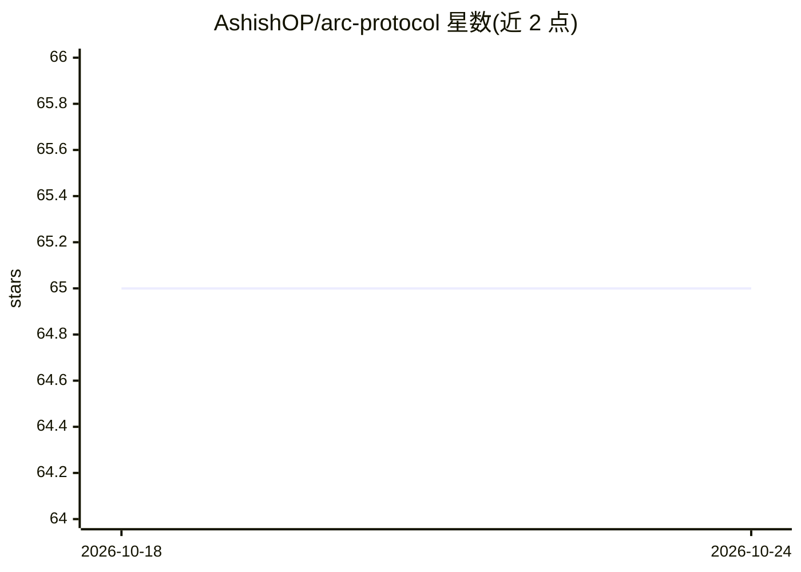

# AshishOP/arc-protocol

⭐ 65 · Python · MIT · 推送 2026-02-02 · [GitHub](https://github.com/AshishOP/arc-protocol) · 个人维护

**约束 AI 辅助开发的本地 agentic 工作流协议（ARC）**

面向使用 AI 编辑器的开发者的协调层：通过 Analyze-Run-Confirm 流程与斜杠触发词（/arc-new、/arc-plan、/arc-execute、/arc-verify 等）驱动多专家 agent（Research、Build、Audit）协作完成项目，要求提交前检查 CONTRACTS.md，支持扫描现有代码库生成 CODEBASE_MAP.md，并带持久上下文的 Dashboard。需 Python 3.10+ 与 Node.js 18+，通过 Google 账号做 Gemini 认证桥接（无需 API key），在 Claude、Windsurf、Antigravity 等 AI 编辑器中使用。MIT 许可，自称 Technical Preview。

## 筛选速览

| 维度 | 判定 | 备注 |
|---|---|---|
| AI 角色 | `ai-ecosystem` | LLM/agent 周边工具 |
| 许可风险 | `permissive` | MIT |
| 部署形态 | `None` |  |
| 模型依赖 | — | README 未给出锁定关系 |
| 硬件要求 | — | 无带数字的原话,不猜 |
| 安装摩擦 | `low` | 无编译、无系统依赖或容器化 |
| 成熟度 | `idea` | |

## 能力要点

- ARC（Analyze/Run/Confirm）流程与斜杠触发词驱动 agent 协作
- 多专家 agent 分工（Research-Agent、Build-Agent、Audit-Agent）
- 提交前强制检查 CONTRACTS.md 的护栏机制
- 支持扫描既有代码库生成 CODEBASE_MAP.md

## 适用场景

- 在 Claude/Windsurf/Antigravity 中用触发词驱动 AI 按流程完成项目
- 让 AI 先映射既有代码库再动手修改
- 通过 Dashboard 观察 agent 执行与验证结果

## 场景标签

`编码 Agent` `多智能体` · 领域:Agent 开发

## 证据(README 行号)

> L15: Most AI tools just "wing it" by looking at one file at a time and hoping for the best. ARC is different. It’s a coo
> L88: * **How It Works (Deep Dive)**: The internal mechanics of MCP and Gemini.

## 星数曲线

2026-10-18 65 → 2026-10-24 65（+0）

---
*卡片 v1 · prompt 1.4 · 生成 2026-10-24 · 置信度 high · 依据 README sha `971f054710ec` · [字段定义](../../DATASET.md)*
