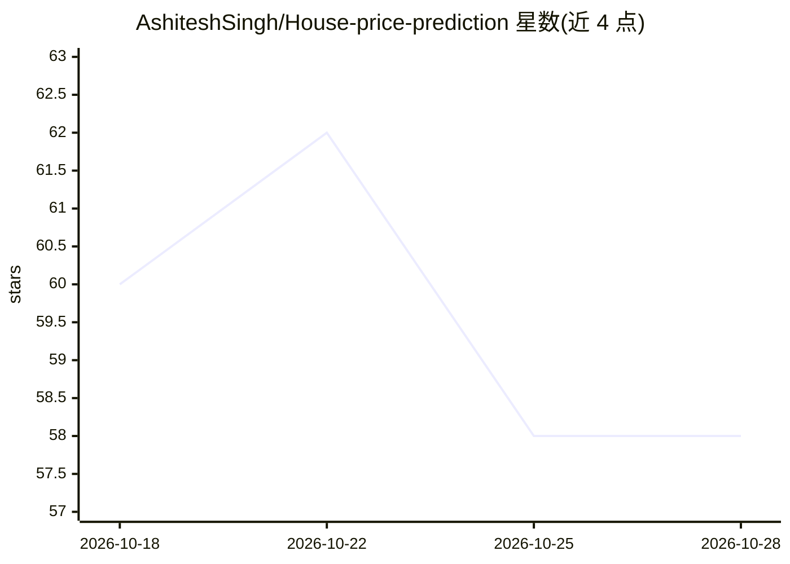

# AshiteshSingh/House-price-prediction

⭐ 58 · Python · 推送 2026-03-27 · [GitHub](https://github.com/AshiteshSingh/House-price-prediction) · [官网](https://ashiteshsingh.github.io/House-price-prediction/) · 个人维护

**印度房价预测系统：5 模型堆叠给出估价**

面向印度 8 个城市（孟买、德里 NCR、班加罗尔等）的房价预测项目：输入城市、面积、BHK、楼层、装修等特征，由 XGBoost、LightGBM、GradientBoosting、ExtraTrees 与 Transformer DNN 五个模型分别预测，再经 Meta-Learner 堆叠合成最终估价。提供 Jupyter 训练/评估 notebook、Flask 本地 Web 应用，以及 GitHub Pages 在线演示与 Hugging Face 模型下载。README 报告 R² 0.9682、MAPE 7.87%。

## 筛选速览

| 维度 | 判定 | 备注 |
|---|---|---|
| AI 角色 | `ai-native` | 本体是模型或模型工具 |
| 许可风险 | `none` | — |
| 部署形态 | `library` | 以包/库形式分发 |
| 模型依赖 | — | README 未给出锁定关系 |
| 硬件要求 | — | 无带数字的原话,不猜 |
| 安装摩擦 | `low` | 无编译、无系统依赖或容器化 |
| 成熟度 | — | 结构信号不足 |

## 能力要点

- 5 个模型（XGBoost/LightGBM/GBR/ExtraTrees/Transformer DNN）堆叠集成
- Flask 本地 Web 应用与 GitHub Pages 在线演示
- 提供训练与评估 notebook，支持 Optuna 调参

## 适用场景

- 按城市、面积、BHK 等特征估算印度房价
- 学习堆叠集成建模与评估流程
- 从 Hugging Face 下载已部署模型自行使用

## 场景标签

 · 领域:机器学习/房地产估值

## 证据(README 行号)

> L9: It uses **5 different AI models** working together like a team — each one makes its own prediction, and then a final
> L76: All 5 predictions are combined by a **Meta-Learner** (stacking) for the final answer.

## 星数曲线

2026-10-18 60 → 2026-10-28 58（-2）

---
*卡片 v1 · prompt 1.4 · 生成 2026-10-24 · 置信度 high · 依据 README sha `17e00e2ba12b` · [字段定义](../../DATASET.md)*
