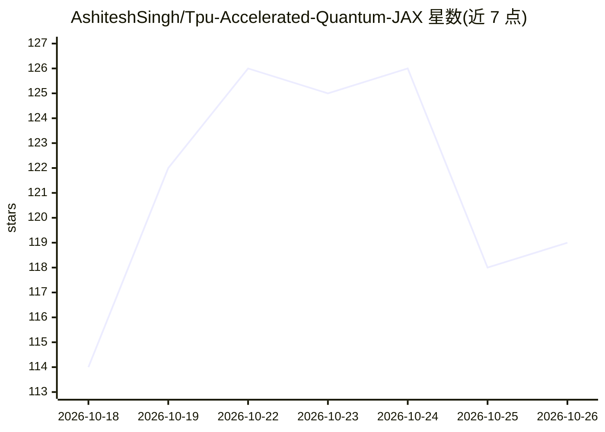

# AshiteshSingh/Tpu-Accelerated-Quantum-JAX

⭐ 119 · Jupyter Notebook · Apache-2.0 · 推送 2026-09-18 · [GitHub](https://github.com/AshiteshSingh/Tpu-Accelerated-Quantum-JAX) · [官网](https://ashitesh.me) · 个人维护

**纯 JAX 实现的量子电路模拟器，支持 GPU 与 Cloud TPU 集群加速**

研究级量子态矢量模拟器，完全用 JAX 编写，不依赖 Qiskit/Cirq/Pennylane 等框架。支持分布式 PositionalSharding 分片，在 64 芯片 TPU v6e 集群上扩展至 36 量子比特（549 GB 态矢量），并提供反向模式自动微分、梯度重计算与蒙特卡洛噪声模拟。面向量子计算与量子机器学习研究者，通过 Google TRC 计划获得 TPU 资源。安装方式为 pip 安装 JAX 依赖并在 venv 中运行，本地 GPU 路径需 CUDA 12。

## 筛选速览

| 维度 | 判定 | 备注 |
|---|---|---|
| AI 角色 | `ai-enhanced` | 去掉 AI 部分产品仍成立 |
| 许可风险 | `permissive` | Apache-2.0 |
| 部署形态 | `library` | 以包/库形式分发 |
| 模型依赖 | — | README 未给出锁定关系 |
| 硬件要求 | `gpu-8g` | |
| 安装摩擦 | `medium` | 含编译或系统依赖之一 |
| 成熟度 | — | 结构信号不足 |

## 能力要点

- 100% 纯 JAX 实现，编译为单一 XLA 内核执行
- 多设备分片扩展至 36 量子比特（549 GB 态矢量）
- jax.grad 反向自动微分支持 VQE/QAOA/QNN 训练
- 内置蒙特卡洛轨迹与去极化噪声模拟

## 适用场景

- 在本地 NVIDIA GPU 上运行与基准测试量子电路
- 在 Cloud TPU 集群上模拟大规模量子电路
- 利用自动微分训练变分量子算法（VQE/QAOA/QNN）
- 研究开放系统与 NISQ 噪声下的电路行为

## 场景标签

 · 领域:量子计算/科学计算

## 证据(README 行号)

> L17: A high-performance, research-grade quantum state-vector simulator built purely in JAX. Run differentiable, noise-re
> L23: - **Reverse-Mode Auto-Differentiation:** Compute exact gradients in a single backward pass via `jax.grad` for fast 

## 星数曲线

2026-10-18 114 → 2026-10-26 119（+5）

---
*卡片 v1 · prompt 1.4 · 生成 2026-10-23 · 置信度 low · 依据 README sha `ed6454698ec5` · [字段定义](../../DATASET.md)*
