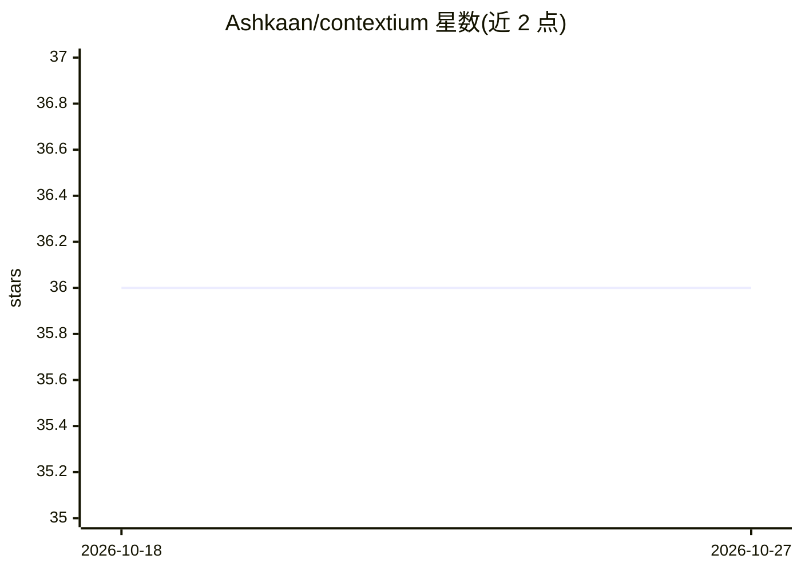

# Ashkaan/contextium

⭐ 36 · TypeScript · MIT · 推送 2026-10-14 · [GitHub](https://github.com/Ashkaan/contextium) · [官网](https://contextium.ai) · 个人维护

**为 AI 编码工具提供持久化上下文与工作流的开源工作台框架**

以一个 git 仓库统一承载项目、工作记录与 AI 技能，通过 AGENTS.md 与 .agents/ 目录让多种 AI 编码工具（Claude Code、Codex、Cursor、VS Code+Copilot、Gemini CLI、Grok Build 等）读取同一份配置。核心机制包括 Think/Do/Wrap 三段式 Loop 流程、每会话独立 git worktree、spec-kit 格式的规格与 MADR 决策记录、提交前六类检查、三层记忆（git log/日志/决策记录），并提供 11 个共享技能与跨模型评审。脚本机制需 Node 22.6+ 运行，刻意不含编排平台与部署流水线。

## 筛选速览

| 维度 | 判定 | 备注 |
|---|---|---|
| AI 角色 | `ai-ecosystem` | LLM/agent 周边工具 |
| 许可风险 | `permissive` | MIT |
| 部署形态 | `None` |  |
| 模型依赖 | — | README 未给出锁定关系 |
| 硬件要求 | — | 无带数字的原话,不猜 |
| 安装摩擦 | `low` | 无编译、无系统依赖或容器化 |
| 成熟度 | — | 结构信号不足 |

## 能力要点

- Think/Do/Wrap 三段式 Loop 流程与新鲜上下文边界
- 每会话独立 git worktree，ROADMAP 逐行合并支持并行会话
- 支持 8 种 AI 编码工具读取同一份 AGENTS.md 与技能
- 提交前运行决策记录、日志、密钥等六类检查与跨模型评审

## 适用场景

- 让 AI 编码会话跨天保留偏好、决策与项目上下文
- 多个 AI 工具共享同一套技能与标准而无需逐工具同步
- 按规格行并行开展独立会话并自动合并落地

## 场景标签

`编码 Agent` `Agent 记忆` · 领域:Agent 开发

## 证据(README 行号)

> L5: Contextium sets up your workbench: one git repo that holds every project you work on, the records of
> L60: The installer's first question is which tool you drive the workbench with. T3 Code is the recommended
> L66: |Tool|Reads `AGENTS.md`|Finds the skills|Guards wired|

## 星数曲线

2026-10-18 36 → 2026-10-27 36（+0）

---
*卡片 v1 · prompt 1.4 · 生成 2026-10-25 · 置信度 high · 依据 README sha `aaa819fcb945` · [字段定义](../../DATASET.md)*
