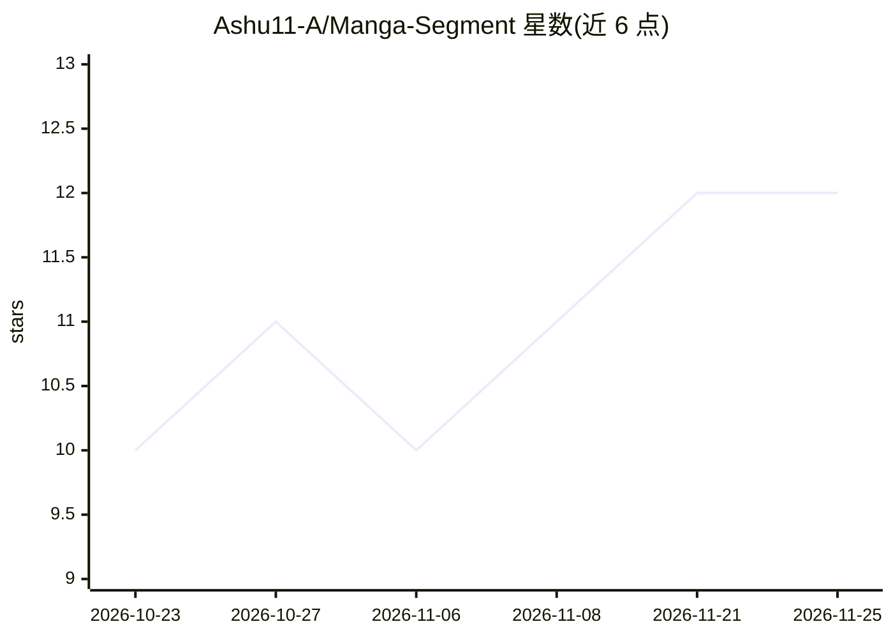

# Ashu11-A/Manga-Segment

⭐ 12 · Python · AGPL-3.0 · 推送 2026-06-20 · [GitHub](https://github.com/Ashu11-A/Manga-Segment) · [官网](https://ashu11-a.github.io/Manga-Segment/) · 个人维护

**面向漫画页分析的分割模型训练与推理工具**

Python 计算机视觉项目，用于漫画和漫画页分析：训练并运行 U-Net 与 YOLO(v8/v11/v26) 分割模型，识别面板、对话气泡、思想气泡、字幕框和文本区域，导出掩码、叠加图、分割图像、报告及服务工具供下游处理。目标场景是漫画自动翻译中的文字区域定位与擦除重绘。附带数据集版本说明与性能对比表，提供 uv 管理的 CLI 和生产代理接口。

## 筛选速览

| 维度 | 判定 | 备注 |
|---|---|---|
| AI 角色 | `ai-native` | 本体是模型或模型工具 |
| 许可风险 | `viral` | AGPL-3.0 |
| 部署形态 | `None` |  |
| 模型依赖 | — | README 未给出锁定关系 |
| 硬件要求 | — | 无带数字的原话,不猜 |
| 安装摩擦 | `medium` | 含编译或系统依赖之一 |
| 成熟度 | — | 结构信号不足 |

## 能力要点

- 支持 U-Net 与 YOLO v8/v11/v26 多种分割模型的训练与推理
- 识别面板、对话气泡、思想气泡、字幕框、文本区域多类目标
- 提供 GET /image 服务接口输出分割或标注后的图像
- 附带多版本标注数据集（v0.3 含 754 图、60419 条标注）

## 适用场景

- 为漫画自动翻译定位并分割含文字的区域
- 批量导出漫画页的气泡/面板掩码与标注叠加图
- 作为漫画图像分割的学术研究与教学实践项目

## 场景标签

`目标检测` `模型训练` · 领域:感知与多模态

## 证据(README 行号)

> L12: Manga Segment is a Python computer-vision project for comic and manga page analysis. It trains and runs segmentatio
> L16: This project was structured and tested with U-Net and Yolo(v8, v11, v26).

## 星数曲线

2026-10-23 10 → 2026-11-25 12（+2）

---
*卡片 v1 · prompt 1.4 · 生成 2026-11-19 · 置信度 high · 依据 README sha `7d13cbb51e81` · [字段定义](../../DATASET.md)*
