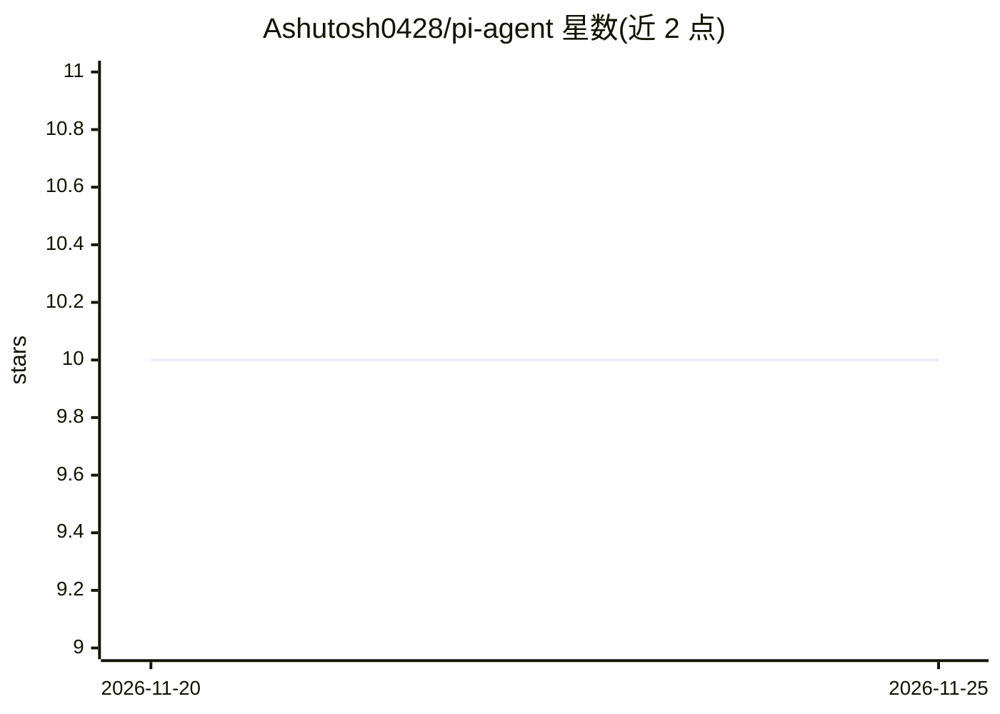

# Ashutosh0428/pi-agent

⭐ 10 · Python · MIT · 推送 2026-06-12 · [GitHub](https://github.com/Ashutosh0428/pi-agent) · [官网](https://mj3ivlmagpfgsjpxirxbpv.streamlit.app/) · 个人维护

**面向开发者的终端 AI 编码代理：LLM 工具循环读写运行代码**

pi-agent 是一个运行在终端的 AI 编码代理，通过 provider 中立的工具调用循环让 LLM 读取、编辑并运行工作目录中的代码，流式展示每次工具调用与 token 成本。核心循环约 150 行，转录格式与提供商无关；支持 12+ 工具（文件读写、apply_patch、只读 git、SSRF 防护的 web_fetch、受限 shell）、MCP 服务器接入、本地 BM25 知识库、持久记忆、18 个 SKILL.md 技能与子代理委派，默认开启护栏（密钥脱敏、危险命令确认）。

## 筛选速览

| 维度 | 判定 | 备注 |
|---|---|---|
| AI 角色 | `ai-native` | 本体是模型或模型工具 |
| 许可风险 | `permissive` | MIT |
| 部署形态 | `self-host` | docker 或自建部署 |
| 模型依赖 | local-ok | 支持本地模型 |
| 硬件要求 | — | 无带数字的原话,不猜 |
| 安装摩擦 | `low` | 无编译、无系统依赖或容器化 |
| 成熟度 | — | 结构信号不足 |

## 能力要点

- provider 中立工具循环：Claude/GPT/Groq/Gemini/OpenRouter/GLM/Ollama 可中途切换
- 12+ 沙箱化工具与 MCP 服务器接入（tools 以 mcp__server__tool 形式出现）
- 本地知识库：pi ingest → BM25 over sqlite → 带引用问答，完全离线
- 默认护栏：阻止密钥外泄、危险命令确认、prompt injection 提示；174 个测试覆盖沙箱边界

## 适用场景

- 在终端让 AI 读取、修改并运行本地代码库
- 离线环境下用本地 Ollama 模型做代码审查与重构
- 上传项目 ZIP 让模型解释项目结构与流程
- CSV/Excel 数据分析并生成 PPTX 演示文稿

## 场景标签

`编码 Agent` `代码审查` `数据分析` · 领域:效率与自动化

## 证据(README 行号)

> L23: pi lets an LLM **read, edit, and run code** in your working directory through a
> L24: tool-use loop — and shows you everything it does. It speaks to **Claude, GPT,
> L29: > Built as a learning + portfolio project. The core loop is ~150 lines; the

## 星数曲线

2026-11-20 10 → 2026-11-25 10（+0）

---
*卡片 v1 · prompt 1.4 · 生成 2026-11-20 · 置信度 high · 依据 README sha `12ec6e21482b` · [字段定义](../../DATASET.md)*
