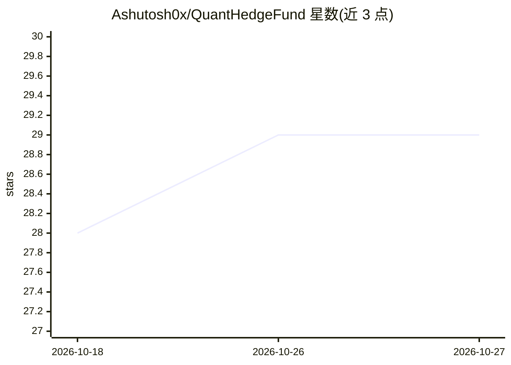

# Ashutosh0x/QuantHedgeFund

⭐ 29 · Python · 推送 2026-03-16 · [GitHub](https://github.com/Ashutosh0x/QuantHedgeFund) · 个人维护

**Python 全流程量化交易系统：数据、回测、执行与监控一体化**

端到端算法交易平台：通过 FMP API 下载 25 年以上行情与基本面数据存入 DuckDB（支持 900M+ 行），用 Zipline 做因子回测与参数扫描，MLflow 记录每次运行的 88+ 指标，Luigi/Prefect 编排任务，经 Interactive Brokers 网关自动下单，Streamlit 面板提供实时监控、HALT/RESUME 熔断与审计日志。AI 部分为可选层：XGBoost 因子增强与 Grok（Llama 3 70B）市场分析、体制识别、止损止盈建议。面向 Python 开发者、量化分析师与个人交易者。

## 筛选速览

| 维度 | 判定 | 备注 |
|---|---|---|
| AI 角色 | `ai-enhanced` | 去掉 AI 部分产品仍成立 |
| 许可风险 | `none` | — |
| 部署形态 | `None` |  |
| 模型依赖 | locked-api |  |
| 硬件要求 | — | 无带数字的原话,不猜 |
| 安装摩擦 | `low` | 无编译、无系统依赖或容器化 |
| 成熟度 | — | 结构信号不足 |

## 能力要点

- FMP API → Parquet 缓存 → DuckDB → Zipline 数据流水线
- MLflow 记录 88+ 指标，回测可复现
- Luigi + Prefect 双编排（开发/生产）与 IB 自动下单
- Grok（Llama 3 70B）市场分析、体制识别与风险护栏（可选）

## 适用场景

- 系统化回测并跟踪多因子策略实验
- 夜间自动下载数据、跑回测并按目标权重调仓
- 通过 Streamlit 面板实时监控持仓与一键暂停交易

## 场景标签

`金融量化` · 领域:学习与行业

## 证据(README 行号)

> L23: The **Quant Hedge Fund System** is a comprehensive, end-to-end algorithmic trading platform that automates the enti
> L28: 4. **Automated Execution** - Execute trades automatically via Interactive Brokers
> L170: |**AI Insight Engine**|**New**: Real-time Grok-powered market analysis (Summary, Regime, Risk, Levels)|

## 星数曲线

2026-10-18 28 → 2026-10-27 29（+1）

---
*卡片 v1 · prompt 1.4 · 生成 2026-10-26 · 置信度 high · 依据 README sha `2e76d31ab5a9` · [字段定义](../../DATASET.md)*
