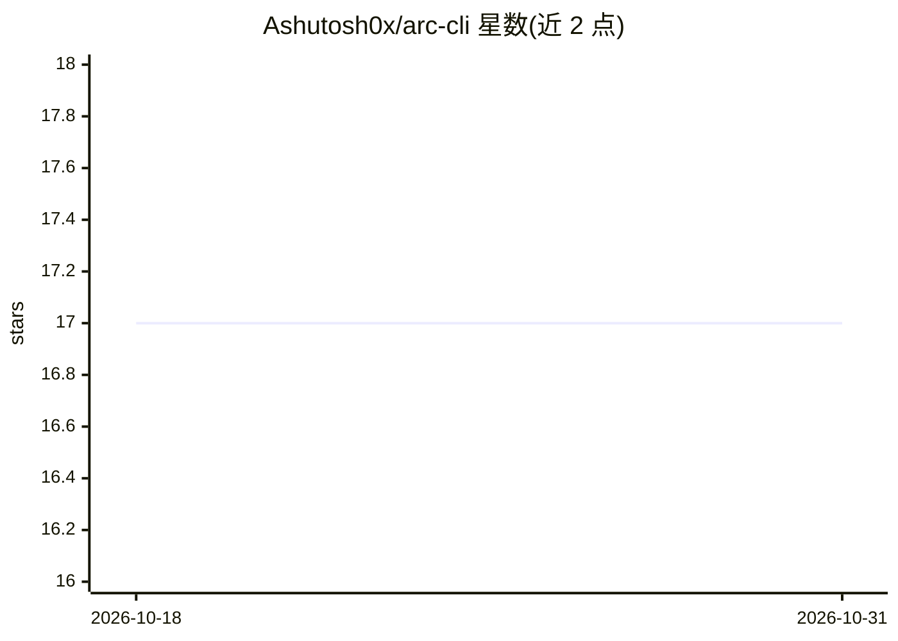

# Ashutosh0x/arc-cli

⭐ 17 · Rust · MIT · 推送 2026-04-09 · [GitHub](https://github.com/Ashutosh0x/arc-cli) · [官网](https://arc-cli-docs.vercel.app) · 个人维护

**Rust 编写的终端原生 AI 编码代理，单二进制多供应商**

用 Rust 实现的终端 AI 编码代理 CLI：指向代码库描述任务后自主规划、编写并验证改动。单一静态二进制，无运行时依赖，声明冷启动 <20ms。可连接 Claude、Gemini、OpenAI、Groq、xAI Grok 或 Ollama（离线），会话内切换供应商并支持故障转移。内含 31 个 crate 分层架构、5 层上下文记忆、Landlock 沙箱与 tree-sitter 命令分析、代码库知识图谱索引（64 语言）与多 agent 编排。通过 install.sh 脚本安装，MIT 许可。

## 筛选速览

| 维度 | 判定 | 备注 |
|---|---|---|
| AI 角色 | `ai-native` | 本体是模型或模型工具 |
| 许可风险 | `permissive` | MIT |
| 部署形态 | `library` | 以包/库形式分发 |
| 模型依赖 | local-ok | 支持本地模型 |
| 硬件要求 | — | 无带数字的原话,不猜 |
| 安装摩擦 | `low` | 无编译、无系统依赖或容器化 |
| 成熟度 | — | 结构信号不足 |

## 能力要点

- 单二进制、无运行时依赖，支持 6 家供应商（含 Ollama 完全离线）
- Plan 模式、检查点回溯、会话分叉、多子 agent 编排
- 代码库知识图谱：索引/结构搜索/调用链追踪/影响分析（64 语言）
- 三层权限引擎、Landlock 沙箱、秘密模式扫描等安全机制

## 适用场景

- 在终端让 AI 代理自主完成代码修改并审查 diff
- 离线环境用 Ollama 跑本地编码代理
- 对代码库做结构化搜索、调用链与变更影响分析
- AI 驱动的 PR 审查与安全扫描

## 场景标签

`编码 Agent` `多智能体` `知识图谱` · 领域:Agent 开发

## 证据(README 行号)

> L24: A native agentic CLI that reasons over codebases. One binary. No runtime. Works offline.
> L37: ARC is a terminal-native AI coding agent. You point it at a codebase, describe what you want, and it plans, writes,

## 星数曲线

2026-10-18 17 → 2026-10-31 17（+0）

---
*卡片 v1 · prompt 1.4 · 生成 2026-10-30 · 置信度 high · 依据 README sha `0e57ffb1695b` · [字段定义](../../DATASET.md)*
