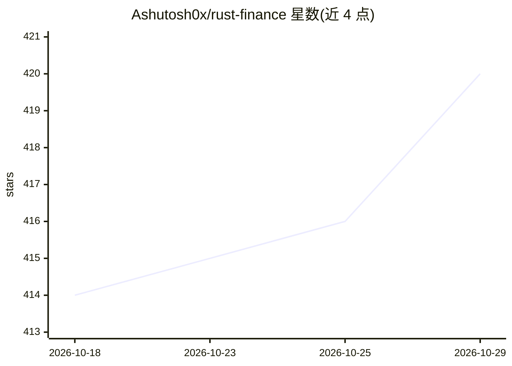

# Ashutosh0x/rust-finance

⭐ 420 · Rust · MIT · 推送 2026-08-21 · [GitHub](https://github.com/Ashutosh0x/rust-finance) · 个人维护

**纯 Rust 编写的低延迟交易终端与 AI 分析守护进程**

面向量化交易研究的基础设施：38 个模块化 crate 组成的工作区，覆盖 Nasdaq ITCH/OUCH、NYSE XDP/Pillar 等交易所原生二进制协议的行情接入与订单通道，L3 订单簿、微结构指标（MLOFI/VPIN/Kyle's Lambda）、执行算法（TWAP/VWAP/Almgren-Chriss）、Avellaneda-Stoikov 做市、GARCH 风控与 TUI 仪表盘。AI 部分为接入 Claude 的 Dexter 分析师与 petgraph 知识图谱 RAG。README 声明为研究与开源基础设施，非实盘就绪，建议先纸面交易。运行需 Rust 工具链从源码编译。

## 筛选速览

| 维度 | 判定 | 备注 |
|---|---|---|
| AI 角色 | `ai-enhanced` | 去掉 AI 部分产品仍成立 |
| 许可风险 | `permissive` | MIT |
| 部署形态 | `None` |  |
| 模型依赖 | locked-api |  |
| 硬件要求 | — | 无带数字的原话,不猜 |
| 安装摩擦 | `low` | 无编译、无系统依赖或容器化 |
| 成熟度 | — | 结构信号不足 |

## 能力要点

- Nasdaq ITCH/OUCH 与 NYSE Pillar 原生二进制协议直连，294 个单元测试
- L3 逐单订单簿与整数精确价格（1e-9 USD 定点）
- TWAP/VWAP/Iceberg/POV/Almgren-Chriss 执行算法与做市引擎
- Claude 驱动的 Dexter AI 分析师与确定性安全门控

## 适用场景

- 研究交易所原生行情与订单协议的低延迟实现
- 量化策略研究：微结构指标、Alpha 信号与执行算法
- 在 TUI 中监控实时加密货币与股票行情

## 场景标签

`金融量化` · 领域:学习与行业

## 证据(README 行号)

> L61: RustFinance Terminal, also called RustForge, is an open-source Rust trading terminal for market-data ingestion, exe
> L82: RustForge is an institutional-grade AI trading terminal built in pure Rust. It combines real-time multi-exchange ma

## 星数曲线

2026-10-18 414 → 2026-10-29 420（+6）

---
*卡片 v1 · prompt 1.4 · 生成 2026-10-21 · 置信度 high · 依据 README sha `64433819dce8` · [字段定义](../../DATASET.md)*
