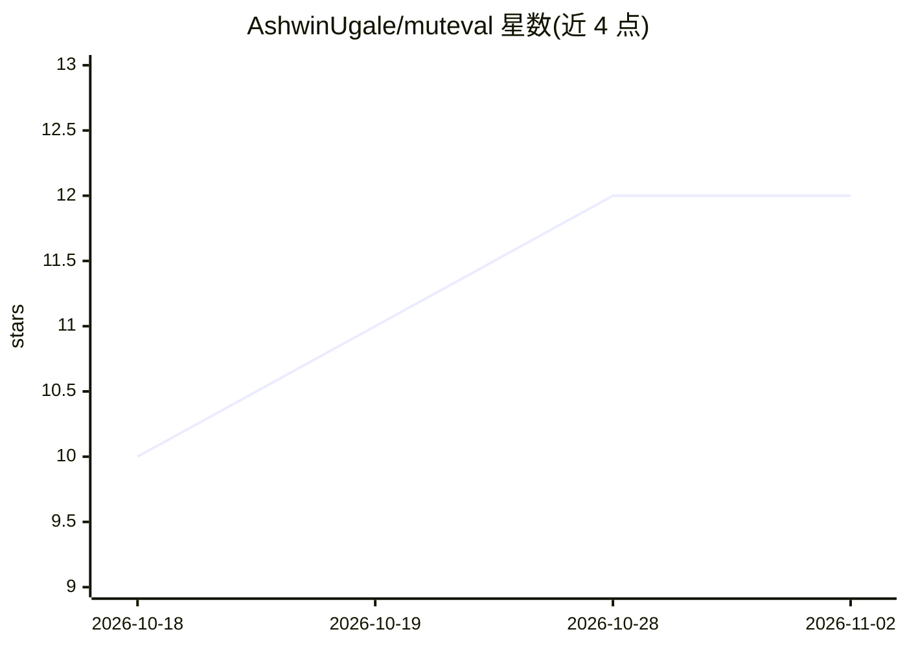

# AshwinUgale/muteval

⭐ 12 · Python · Apache-2.0 · 推送 2026-10-04 · [GitHub](https://github.com/AshwinUgale/muteval) · [官网](https://ashwinugale.github.io/muteval/) · 个人维护

**LLM 评测套件的变异测试工具：检验评测能否发现回归**

面向已构建 LLM/RAG/agent 评测套件的开发者的变异测试 CLI 库：通过 22 个算子对被测系统（prompt、检索上下文、工具输出、模型）注入降级变体，重跑用户现有评测并输出变异分数、存活变体清单与建议补测项。核心为纯 Python 零必需依赖，可选接入 deepeval/RAGAS/promptfoo 适配器与任意 OpenAI 兼容端点。设计上失败即关闭：基线不通过不评分，支持缓存、并发、调用上限与 CI 门禁。作者自述对现有套件的集成约需 1 小时，非即插即用。

## 筛选速览

| 维度 | 判定 | 备注 |
|---|---|---|
| AI 角色 | `ai-ecosystem` | LLM/agent 周边工具 |
| 许可风险 | `permissive` | Apache-2.0 |
| 部署形态 | `library` | 以包/库形式分发 |
| 模型依赖 | — | README 未给出锁定关系 |
| 硬件要求 | — | 无带数字的原话,不猜 |
| 安装摩擦 | `low` | 无编译、无系统依赖或容器化 |
| 成熟度 | — | 结构信号不足 |

## 能力要点

- 22 个变异算子覆盖 prompt / 检索上下文 / 工具输出 / 模型
- 变异分数 + 存活变体分级排序 + 建议补测项
- 失败即关闭：基线失败不评分，坏 judge 回复计为错误
- --cache 缓存重跑、--max-calls 花费上限、CI 门禁与覆盖率徽章
- 复用现有 deepeval / RAGAS / promptfoo 指标与套件

## 适用场景

- 检验我的 LLM 评测套件是否真能发现系统回归
- 在 CI 中对评测覆盖率设门禁，防止 PR 削弱评测
- 对 RAG/agent 系统的 prompt 与检索质量做覆盖缺口排查

## 场景标签

`模型评测` · 领域:评测与运维

## 证据(README 行号)

> L14: muteval answers the question every eval suite quietly dodges: *would my evals
> L163: muteval fills — mutation testing is the established answer to "is my test suite
> L160: Regression tools (promptfoo, deepeval, OpenAI Evals, LangSmith) catch

## 星数曲线

2026-10-18 10 → 2026-11-02 12（+2）

---
*卡片 v1 · prompt 1.4 · 生成 2026-11-01 · 置信度 high · 依据 README sha `6e1bef0f589e` · [字段定义](../../DATASET.md)*
