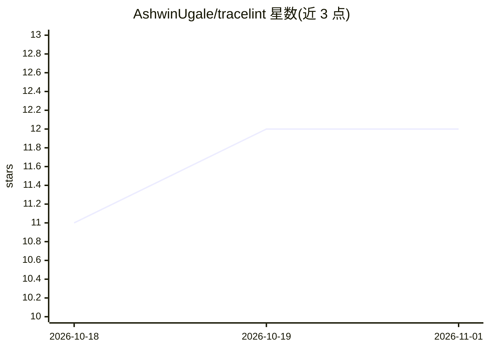

# AshwinUgale/tracelint

⭐ 12 · Python · MIT · 推送 2026-10-21 · [GitHub](https://github.com/AshwinUgale/tracelint) · [官网](https://tracelint.com) · 个人维护

**确定性 Agent 执行轨迹检查器：以规则与证据标记结构缺陷**

面向工具调用型 AI agent 的轨迹静态检查工具：读取 OpenInference/OpenAI/Langfuse/LangSmith 等格式的执行轨迹文件，以 13 条确定性规则（R1-R13）标记 schema 违规、错误被忽略后的副作用、幻觉参数、循环调用、重复副作用等结构缺陷，不使用 LLM judge。输出带证据的报告与 CI 退出码（可证明缺陷返回 2），支持 GitHub Action、SARIF 与 pre-commit 接入。提供 capture 辅助器包装 smolagents/LangChain/CrewAI 的 OpenInference 埋点录制轨迹。限制：只查结构缺陷不判断最终答案正确性；部分规则产出候选级发现需人工复核。

## 筛选速览

| 维度 | 判定 | 备注 |
|---|---|---|
| AI 角色 | `ai-ecosystem` | LLM/agent 周边工具 |
| 许可风险 | `permissive` | MIT |
| 部署形态 | `library` | 以包/库形式分发 |
| 模型依赖 | — | README 未给出锁定关系 |
| 硬件要求 | — | 无带数字的原话,不猜 |
| 安装摩擦 | `low` | 无编译、无系统依赖或容器化 |
| 成熟度 | — | 结构信号不足 |

## 能力要点

- 13 条确定性规则（R1-R13）覆盖 schema 违规、循环、幻觉参数、重复副作用等
- 以 pip 安装的 Python CLI，退出码 0/1/2/3 直接门禁 CI
- 读取 6 种轨迹格式（native/openinference/openai/langfuse/langsmith/atif），无需平台账号
- tracelint init 可从轨迹或 MCP tools/list 响应引导生成 tools.json 工具契约

## 适用场景

- 在 CI 中对 agent 测试运行的轨迹做结构缺陷门禁
- 本地检查 agent 是否存在循环调用、被忽略的错误或幻觉参数
- 审计批量轨迹的记录质量（doctor --fail-under 质量门禁）

## 场景标签

`模型评测` · 领域:评测与运维

## 证据(README 行号)

> L6: It reads what a tool-calling agent *actually did* — the execution trace — and flags structural bugs
> L23: run agent in tests → capture the trace → run tracelint → fail CI on provable defects

## 星数曲线

2026-10-18 11 → 2026-11-01 12（+1）

---
*卡片 v1 · prompt 1.4 · 生成 2026-11-01 · 置信度 high · 依据 README sha `5fa367cfa4e8` · [字段定义](../../DATASET.md)*
