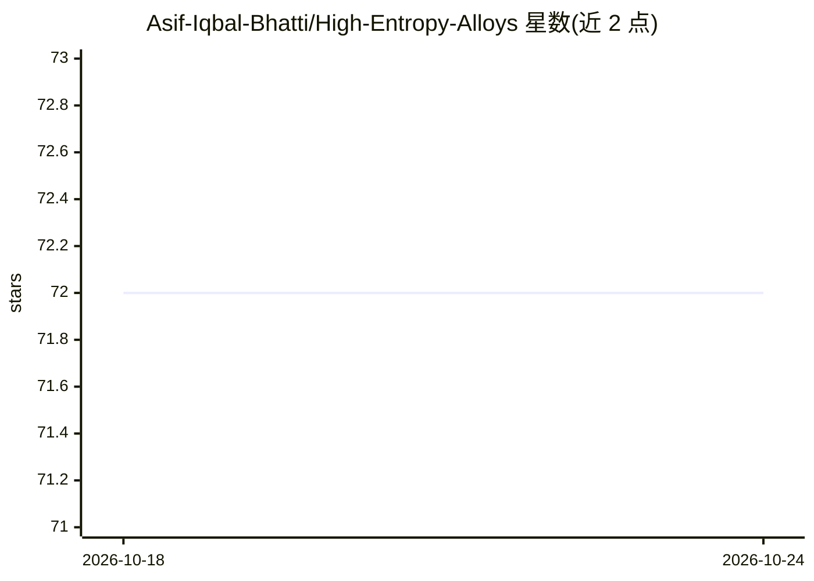

# Asif-Iqbal-Bhatti/High-Entropy-Alloys

⭐ 72 · Python · NOASSERTION · 推送 2026-05-26 · [GitHub](https://github.com/Asif-Iqbal-Bhatti/High-Entropy-Alloys) · [官网](https://asif-iqbal-bhatti.github.io/High-Entropy-Alloys/) · 个人维护

**高熵合金计算脚本集：结构生成、热力学与 ML 性质预测**

由 Python（含少量 C++/Fortran）脚本组成的计算材料学工具集，覆盖高熵合金全流程：SQS 结构生成与 MCSQS/POSCAR 转换、短程序参数与构型熵计算、螺位错与层错能分析、基于 GRACE 机器学习势的 Metropolis 蒙特卡洛、VASP 机器学习力场数据提取与误差分析，以及 TensorFlow/PyTorch 深度网络预测合金性质。脚本配套已发表论文，面向计算材料学研究者使用，需自行配置 VASP/LAMMPS 等外部软件与依赖库，无打包安装入口。

## 筛选速览

| 维度 | 判定 | 备注 |
|---|---|---|
| AI 角色 | `ai-native` | 本体是模型或模型工具 |
| 许可风险 | `none` | NOASSERTION |
| 部署形态 | `None` |  |
| 模型依赖 | — | README 未给出锁定关系 |
| 硬件要求 | — | 无带数字的原话,不猜 |
| 安装摩擦 | `low` | 无编译、无系统依赖或容器化 |
| 成熟度 | — | 结构信号不足 |

## 能力要点

- SQS 结构生成与 MCSQS/POSCAR 格式转换、BCC/FCC/HCP 格点准备
- GRACE 机器学习势驱动的 Metropolis 蒙特卡洛寻找最低能量构型
- VASP ML-FF 训练帧提取与力/能量误差分析、MPtrj 数据集筛选
- TF/Keras 深度网络与 PyTorch 网络预测 HEA 性质和短程序参数

## 适用场景

- 生成高熵合金 SQS 结构并转入 VASP 计算
- 用机器学习势做蒙特卡洛模拟寻找低能量原子构型
- 从 VASP 输出构建机器学习数据集并训练性质预测模型
- 分析合金短程序、构型熵与弹性/表面性质

## 场景标签

`科研工具` `模型训练` · 领域:学习与行业

## 证据(README 行号)

> L3: A collection of Python (and some C++/Fortran) scripts for first-principles and machine-learning-based analysis of Hi
> L64: |`ML_DNN_with_TensorFlowKeras/DeepNeuralNetwrok_TF_HEA.py`|Deep neural network (TF/Keras) for HEA property regressi
> L67: |`pred_short_range_order_pytorch.py`|PyTorch neural network trained on Materials Project data to predict SRO / allo

## 星数曲线

2026-10-18 72 → 2026-10-24 72（+0）

---
*卡片 v1 · prompt 1.4 · 生成 2026-10-24 · 置信度 high · 依据 README sha `38094ecf7798` · [字段定义](../../DATASET.md)*
