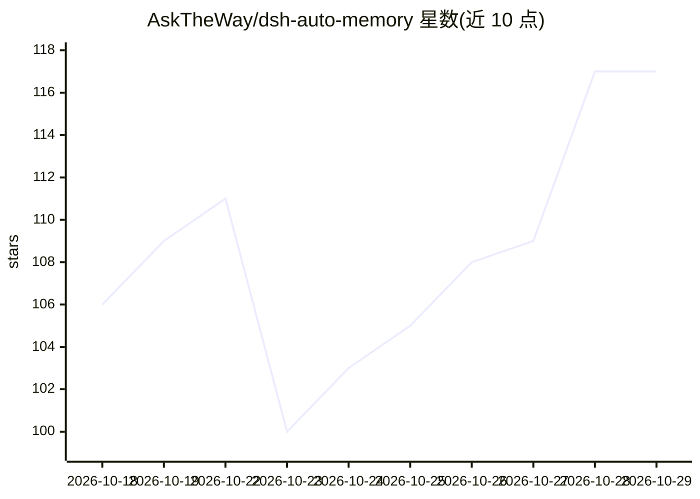

# AskTheWay/dsh-auto-memory

⭐ 117 · TypeScript · MIT · 推送 2026-10-27 · [GitHub](https://github.com/AskTheWay/dsh-auto-memory) · 个人维护

**给 DeepSeek Harness 补上 Claude Code 式持久记忆的插件**

面向 DeepSeek Harness（dsh）的插件：把类型化记忆文件（user/feedback/project/reference）加 MEMORY.md 索引自动注入每次系统提示，存储为普通 Markdown 文件，无外部服务、无嵌入。提供 memory_write/read/list/delete 工具、信任状态（candidate/verified/disputed/superseded）与证据引用核验、从 Claude Code 只读导入并可撤销、跨进程锁与原子写、注入字节预算上限（空库注入 0 字节）。需要 Node ^22.19 或 >=24，dsh >= 0.1.5-rc.2。

## 筛选速览

| 维度 | 判定 | 备注 |
|---|---|---|
| AI 角色 | `ai-ecosystem` | LLM/agent 周边工具 |
| 许可风险 | `permissive` | MIT |
| 部署形态 | `library` | 以包/库形式分发 |
| 模型依赖 | locked-api |  |
| 硬件要求 | — | 无带数字的原话,不猜 |
| 安装摩擦 | `low` | 无编译、无系统依赖或容器化 |
| 成熟度 | — | 结构信号不足 |

## 能力要点

- 类型化记忆 + MEMORY.md 索引自动注入系统提示，空库注入 0 字节
- 纯文件存储（$DSH_HOME/memory/），可手改、可 grep，无外部服务
- 信任状态与逐字证据核验，伪造引用会被丢弃
- 从 Claude Code 只读导入，可按条目撤销且不改动源文件

## 适用场景

- 让 dsh agent 跨会话记住用户偏好与项目经验
- 从 Claude Code 迁移已有记忆到 DeepSeek Harness
- 在面板中审查未验证/冲突的记忆条目

## 场景标签

`Agent 记忆` · 领域:Agent 开发

## 证据(README 行号)

> L13: > DeepSeek Harness — native,
> L43: `dsh-auto-memory` closes that gap natively:

## 星数曲线

2026-10-18 106 → 2026-10-29 117（+11）

---
*卡片 v1 · prompt 1.4 · 生成 2026-10-23 · 置信度 high · 依据 README sha `999f95d4a95d` · [字段定义](../../DATASET.md)*
