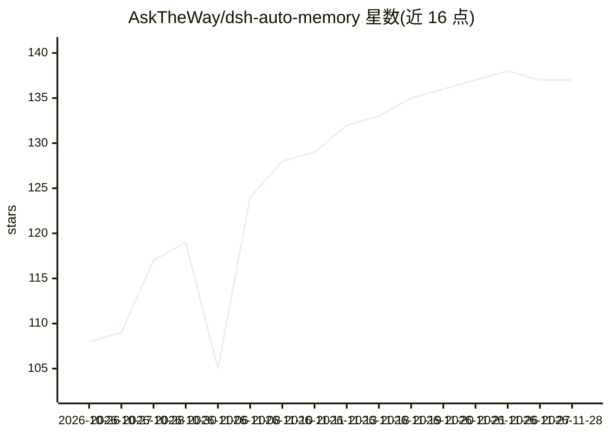

# AskTheWay/dsh-auto-memory

⭐ 137 · TypeScript · MIT · 推送 2026-11-23 · [GitHub](https://github.com/AskTheWay/dsh-auto-memory) · 个人维护 · 中文 README

**为 DeepSeek Harness 代理提供本地持久记忆的插件**

以 dsh 插件形式为 DeepSeek Harness 提供持久记忆子系统：记忆为 Markdown 文件（YAML frontmatter、每条一文件），经四态信任机（candidate/verified/disputed/superseded）与逐字证据引文管控注入；每个系统请求携带字节预算化的记忆索引段，支持用户/工作区两级作用域、有效期（validUntil）、健康看板、注入审计与召回漏斗。提供与 Claude Code 记忆的双向导入导出及 AGENTS.md 导出。零服务器、零嵌入，无需 API key 即可运行演示脚本。

## 筛选速览

| 维度 | 判定 | 备注 |
|---|---|---|
| AI 角色 | `ai-ecosystem` | LLM/agent 周边工具 |
| 许可风险 | `permissive` | MIT |
| 部署形态 | `library` | 以包/库形式分发 |
| 模型依赖 | locked-api |  |
| 硬件要求 | — | 无带数字的原话,不猜 |
| 安装摩擦 | `low` | 无编译、无系统依赖或容器化 |
| 成熟度 | — | 结构信号不足 |

## 能力要点

- 四态信任机 + 逐字证据引文，fabricated 引文被校验丢弃
- 每请求注入的记忆索引段为字节预算硬上限，空存储注入 0 字节
- 与 Claude Code 记忆双向导入导出（含 origin 块可撤销）
- 确定性评测层在 CI 运行，无 LLM、可复现

## 适用场景

- 让 dsh 编码代理跨会话记住用户偏好与项目经验
- 管理代理记忆的可信度：只让用户验证过的记忆持续注入
- 把 Claude Code 中的记忆迁移到 dsh 或导出到 AGENTS.md 工具链

## 场景标签

`Agent 记忆` · 领域:Agent 开发

## 证据(README 行号)

> L13: > DeepSeek Harness — native,
> L24: dsh-auto-memory — persistent memory for DeepSeek Harness
> L68: DeepSeek Harness is the hottest open agent harness on GitHub right now —

## 星数曲线

2026-10-26 108 → 2026-11-28 137（+29）

---
*卡片 v1 · prompt 1.4 · 生成 2026-11-28 · 置信度 high · 依据 README sha `b75782f8a382` · [字段定义](../../DATASET.md)*
