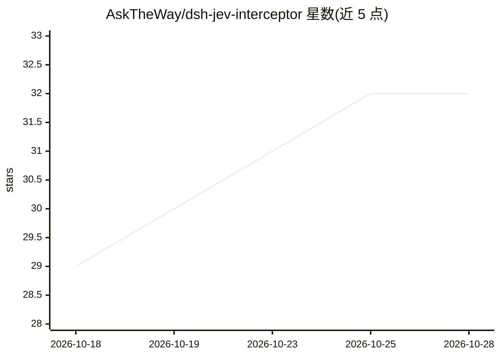

# AskTheWay/dsh-jev-interceptor

⭐ 32 · TypeScript · MIT · 推送 2026-10-27 · [GitHub](https://github.com/AskTheWay/dsh-jev-interceptor) · 个人维护 · 中文 README

**DeepSeek Harness 的 Jev 决策模型安全插件：毫秒级工具调用风险分级**

面向 DeepSeek Harness（dsh）的插件，将非生成式决策模型 Jev 接入 agent 的两个决策点：一是工具调用前的守卫，一次约 $0.00002 的请求对风险、不可逆性、任务匹配度与注入嫌疑做分级——高风险拒绝、中风险升级人工、低风险可逆调用免确认，任何超时/缺 key/解析失败均回退到原生行为（fail-closed）；二是接管 @session 快照的保留策略，按消息价值排序丢弃而非纯 FIFO。默认 shadow 模式先记录不动手，经 /jev-stats、/jev-calibrate 校验后可切 enforce。通过 dsh plugin 命令安装，需 Node >= 20.3，提供 OpenRouter/TypeSafe/Laya 等可换的 provider，130 个测试覆盖。

## 筛选速览

| 维度 | 判定 | 备注 |
|---|---|---|
| AI 角色 | `ai-ecosystem` | LLM/agent 周边工具 |
| 许可风险 | `permissive` | MIT |
| 部署形态 | `library` | 以包/库形式分发 |
| 模型依赖 | — | README 未给出锁定关系 |
| 硬件要求 | — | 无带数字的原话,不猜 |
| 安装摩擦 | `low` | 无编译、无系统依赖或容器化 |
| 成熟度 | — | 结构信号不足 |

## 能力要点

- 工具调用前毫秒级风险分级，单次决策约 $0.00002
- fail-closed 设计：缺 key/超时/错误一律回退原生行为，绝不放大权限
- 会话快照按消息价值（noise/background/relevant/critical）保留而非 FIFO 丢弃
- shadow→enforce 灰度路径，/jev-stats 输出完整概率分布，/jev-calibrate 阈值建议不自动应用

## 适用场景

- 给 agent 的工具调用加风险守卫，减少审批弹窗同时拦截高危操作
- 注入长会话快照时保住关键报错信息而非最旧消息
- 先以 shadow 模式观察决策质量再决定是否启用强制拦截

## 场景标签

`网络安全` · 领域:学习与行业

## 证据(README 行号)

> L18: **What it does, in one breath:** before a tool call runs, Jev classifies its risk, irreversibility, task-fit, and i
> L47: dsh plugin --profile <name> add dsh-jev-interceptor

## 星数曲线

2026-10-18 29 → 2026-10-28 32（+3）

---
*卡片 v1 · prompt 1.4 · 生成 2026-10-26 · 置信度 high · 依据 README sha `a3bf689373ca` · [字段定义](../../DATASET.md)*
