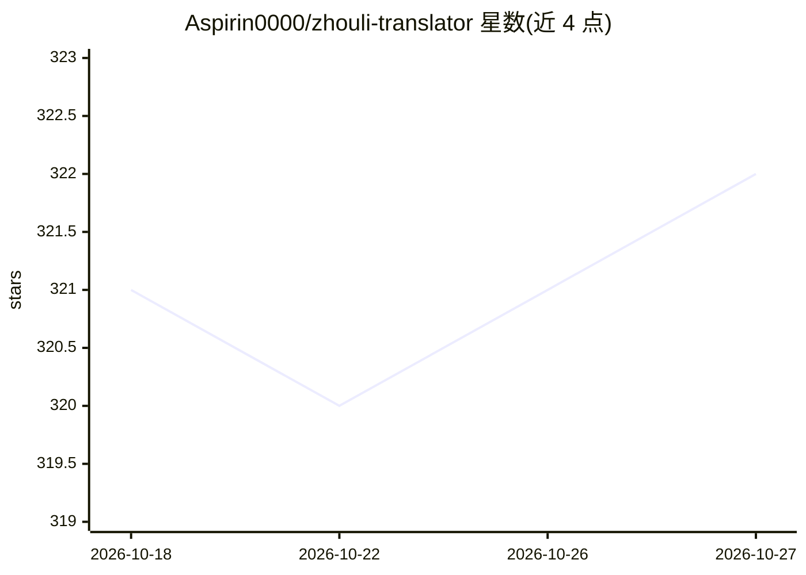

# Aspirin0000/zhouli-translator

⭐ 322 · TypeScript · MIT · 推送 2026-10-26 · [GitHub](https://github.com/Aspirin0000/zhouli-translator) · [官网](https://hehuzhouli.com/) · 个人维护 · 中文 README

**中文梗文案生成器：普通话↔周礼体双向翻译 Web 应用**

基于 Next.js 的 Web 应用与可分发的 Skill 包，调用 DeepSeek Chat Completions 做双向文本改写：问礼把普通中文写成周礼体翻译腔（温言相劝、大儒辩经等 4 模式），释礼把周礼体翻回直接人话（3 种模式），支持三档长度、礼帖/释帖图片导出与匿名反馈统计。无 API Key 时回退本地演示输出。服务端含输入校验、内存限流、提示词 A/B 实验；部署支持 Cloudflare Workers + D1、Vercel 与自托管 Node。

## 筛选速览

| 维度 | 判定 | 备注 |
|---|---|---|
| AI 角色 | `ai-native` | 本体是模型或模型工具 |
| 许可风险 | `permissive` | MIT |
| 部署形态 | `desktop` | 安装包/桌面程序 |
| 模型依赖 | locked-api |  |
| 硬件要求 | — | 无带数字的原话,不猜 |
| 安装摩擦 | `low` | 无编译、无系统依赖或容器化 |
| 成熟度 | — | 结构信号不足 |

## 能力要点

- 问礼/释礼双向翻译，多种模式与三档长度
- speak-zhouli Skill 包支持全文复制与 ZIP 下载
- 无 API Key 时演示模式可预览界面
- 内置密钥扫描审计脚本与批量回归测试

## 适用场景

- 把日常吐槽改写成周礼体梗文案
- 看不懂周礼体文风时翻回直接人话
- 把问礼/释礼结果生成图片分享

## 场景标签

`AI 写作` · 领域:内容生成

## 证据(README 行号)

> L29: `合乎周礼` 是一个中文梗文案生成器，也是一个周礼体反向解释器。它支持两种方向：
> L47: - DeepSeek Chat Completions 调用逻辑。

## 星数曲线

2026-10-18 321 → 2026-10-27 322（+1）

---
*卡片 v1 · prompt 1.4 · 生成 2026-10-21 · 置信度 high · 依据 README sha `4dffda0e7fde` · [字段定义](../../DATASET.md)*
