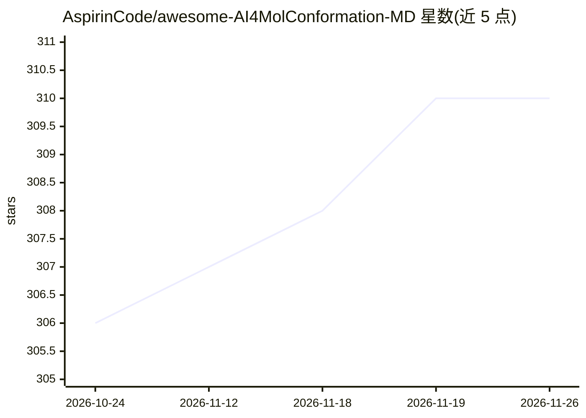

# AspirinCode/awesome-AI4MolConformation-MD

⭐ 310 · GPL-3.0 · 推送 2026-11-24 · [GitHub](https://github.com/AspirinCode/awesome-AI4MolConformation-MD) · 个人维护

**面向计算化学研究者的 AI 分子构象与 MD 资源清单**

一个 awesome 类论文/资源清单，收录使用生成式人工智能与深度学习生成分子（小分子、RNA、肽、蛋白质、酶、抗体、PPI）构象以及分子动力学力场相关的文献、数据集与软件包。按菜单组织：综述、数据集与包、分子动力学、力场、神经网络势，并按方法分类（AlphaFold、自回归、LSTM、Transformer、VAE、GAN、Flow、Diffusion、Score、GNN、LLM 等）。标注 GPL 许可，标注 Updating。

## 筛选速览

| 维度 | 判定 | 备注 |
|---|---|---|
| AI 角色 | `ai-knowledge` | 知识聚合/清单类 |
| 许可风险 | `viral` | GPL-3.0 |
| 部署形态 | `None` |  |
| 模型依赖 | — | README 未给出锁定关系 |
| 硬件要求 | — | 无带数字的原话,不猜 |
| 安装摩擦 | `medium` | 含编译或系统依赖之一 |
| 成熟度 | — | 结构信号不足 |

## 能力要点

- 按方法类型（GAN/VAE/Diffusion/Flow/GNN/LLM 等）分类收录文献
- 覆盖多类分子对象：小分子、RNA、肽、蛋白质、酶、抗体、PPI
- 收录数据集（OMol25、nablaDFT 等）与 Python 包条目

## 适用场景

- 查找用生成模型做分子构象采样的论文线索
- 查找机器学习原子间势与分子模拟基准数据集
- 了解 AI4MD 领域的综述与研究现状

## 场景标签

`精选清单` · 领域:学习与行业

## 证据(README 行号)

> L3: ## awesome-AI4MolConformation-MD
> L4: List of **molecules ( small molecules, RNA, peptide, protein, enzymes, antibody, and PPIs) conformations** and **mol
> L16: |Reviews|Datasets and Package|Molecular dynamics|Molecular Force Fields|

## 星数曲线

2026-10-24 306 → 2026-11-26 310（+4）

---
*卡片 v1 · prompt 1.4 · 生成 2026-11-25 · 置信度 high · 依据 README sha `f8da71e14ac3` · [字段定义](../../DATASET.md)*
