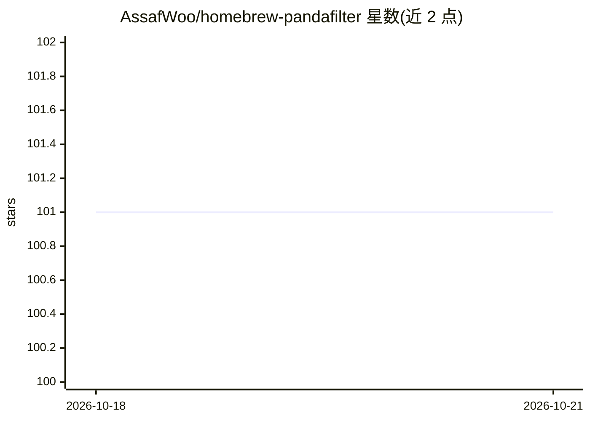

# AssafWoo/homebrew-pandafilter

⭐ 101 · Rust · MIT · 推送 2026-06-12 · [GitHub](https://github.com/AssafWoo/homebrew-pandafilter) · [官网](https://assafwoo.github.io/homebrew-pandafilter/) · 个人维护

**AI 编码 agent 的上下文过滤层：压缩命令输出、降低 token 消耗**

运行在本机命令与 AI 编码 agent 之间的 CLI 工具：拦截 pip/cargo/git 等命令输出，经 BERT（all-MiniLM-L6-v2，首次运行从 HuggingFace 下载约 90MB）驱动的 59 个 handler 过滤、去重和语义压缩，只保留错误、警告与结果；v1.3.0 增加按内容类型分派策略的自适应路由、文件重读改为 diff/结构摘要、以及 Claude Code 上下文 compaction 后的会话摘要保留。通过 panda init 自动接入 Claude Code、Cursor、Gemini CLI、Codex、Windsurf、Cline、VS Code Copilot、OpenClaw 共 8 种 agent，MIT 许可，完全本地运行。

## 筛选速览

| 维度 | 判定 | 备注 |
|---|---|---|
| AI 角色 | `ai-ecosystem` | LLM/agent 周边工具 |
| 许可风险 | `permissive` | MIT |
| 部署形态 | `self-host` | docker 或自建部署 |
| 模型依赖 | — | README 未给出锁定关系 |
| 硬件要求 | — | 无带数字的原话,不猜 |
| 安装摩擦 | `low` | 无编译、无系统依赖或容器化 |
| 成熟度 | — | 结构信号不足 |

## 动量与使用信号

- 下载:GitHub Release 附件 累计 595(90 个 release)

## 能力要点

- 59 个 handler（70+ 命令别名）过滤常见构建/测试/CLI 命令输出，README 基准表称总 token 节省 82%
- BERT（all-MiniLM-L6-v2）语义压缩与未知命令的 embedding 相似度路由
- 一次命令（panda init --agent all）自动接入 8 种 AI 编码 agent
- panda gain / doctor / focus / index 等 CLI 子命令统计节省与诊断安装

## 适用场景

- 降低 Claude Code/Cursor 等 AI 编码 agent 的上下文 token 消耗
- 让 agent 看到干净的命令输出摘要而非冗长日志
- 跨 compaction 保留编辑文件、错误特征等会话关键信息

## 场景标签

`Agent 记忆` · 领域:Agent 开发

## 证据(README 行号)

> L5:  The context intelligence layer for AI coding agents.
> L56: Auto-detects Claude Code, Cursor, Gemini CLI, Codex, Windsurf, Cline, OpenClaw, and VS Code Copilot. Skips anything
> L67: ### 1. Intelligent Compression

## 星数曲线

2026-10-18 101 → 2026-10-21 101（+0）

---
*卡片 v1 · prompt 1.4 · 生成 2026-10-18 · 置信度 mid · 依据 README sha `7d8dd6db2e35` · [字段定义](../../DATASET.md)*
