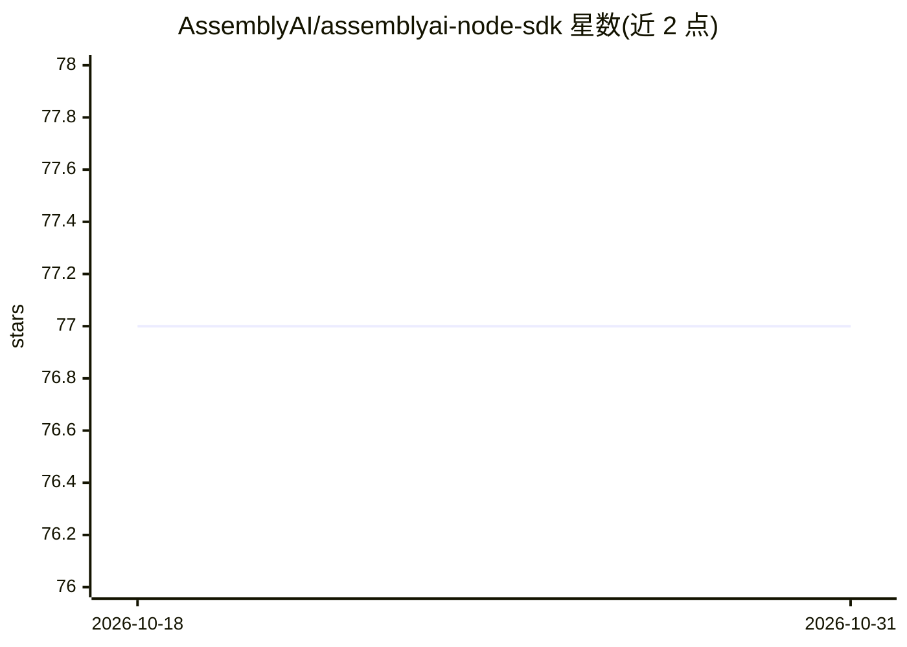

# AssemblyAI/assemblyai-node-sdk

⭐ 77 · TypeScript · MIT · 推送 2026-10-29 · [GitHub](https://github.com/AssemblyAI/assemblyai-node-sdk) · [官网](https://www.assemblyai.com) · 组织维护

**面向开发者的 AssemblyAI 语音转文字 API 的 JavaScript/TypeScript SDK**

AssemblyAI 官方 Node.js SDK（TypeScript 编写并导出全部类型），封装 AssemblyAI 云端 API 的异步与流式转写：支持从 URL、本地文件、流或 Buffer 提交转写任务并轮询结果，可开启说话人分离等语音理解模型，导出 SRT/VTT 字幕与句子/段落；另提供同步接口 client.sync，支持边录音边上传的 openLive()/transcribeLive() 与连接预热 warm()。需 AssemblyAI API key，也可经 CDN 在浏览器加载。

## 筛选速览

| 维度 | 判定 | 备注 |
|---|---|---|
| AI 角色 | `ai-ecosystem` | LLM/agent 周边工具 |
| 许可风险 | `permissive` | MIT |
| 部署形态 | `library` | 以包/库形式分发 |
| 模型依赖 | — | README 未给出锁定关系 |
| 硬件要求 | — | 无带数字的原话,不猜 |
| 安装摩擦 | `low` | 无编译、无系统依赖或容器化 |
| 成熟度 | — | 结构信号不足 |

## 能力要点

- 异步转写与轮询/分页/删除，支持 URL、本地文件、流、Buffer 输入
- 同步转写接口：单次往返返回结果，支持边录边传与连接预热 warm()
- 可开启说话人分离等 Speech Understanding 模型，导出 SRT/VTT 字幕与词级时间戳
- 附带 CLAUDE.md 及面向 AI 编程助手（Claude Code/Cursor/Copilot）的集成说明与 MCP 文档服务器

## 适用场景

- 在 Node.js 应用中集成 AssemblyAI 的音频/视频转写
- 为通话录音或直播场景实现边录边传的同步转写
- 生成字幕文件与带说话人标注的会议记录

## 场景标签

`语音识别` · 领域:感知与多模态

## 证据(README 行号)

> L11: The AssemblyAI JavaScript SDK provides an easy-to-use interface for interacting with the AssemblyAI API,
> L13: It is written primarily for Node.js in TypeScript with all types exported, but also compatible with other runtimes.

## 星数曲线

2026-10-18 77 → 2026-10-31 77（+0）

---
*卡片 v1 · prompt 1.4 · 生成 2026-10-24 · 置信度 high · 依据 README sha `f251a4d200b8` · [字段定义](../../DATASET.md)*
