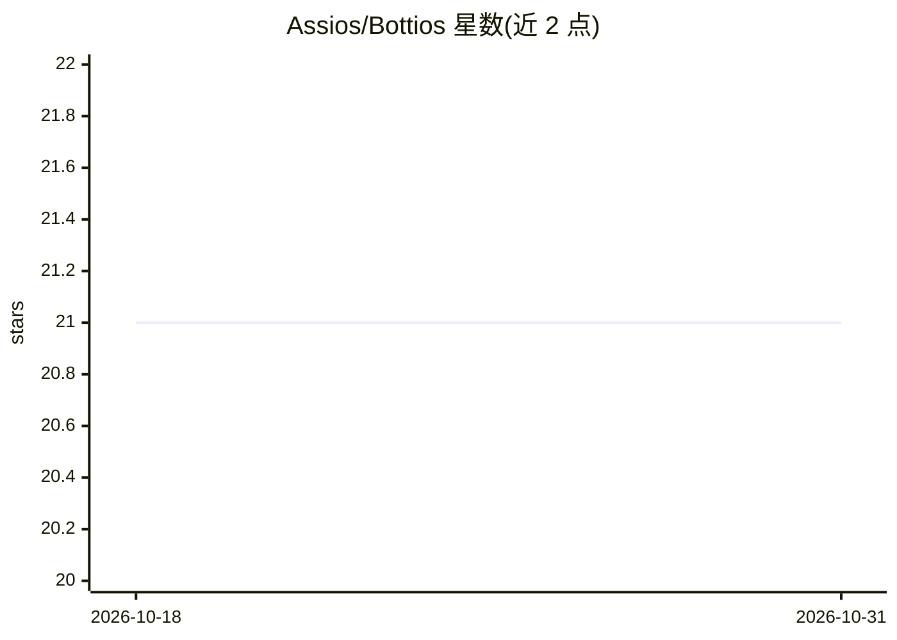

# Assios/Bottios

⭐ 21 · Python · GPL-3.0 · 推送 2026-08-19 · [GitHub](https://github.com/Assios/Bottios) · [官网](https://lichess.org/@/Bottios) · 个人维护

**在 Lichess 上对弈的国际象棋引擎机器人**

用 Python 编写的国际象棋引擎，通过 python-chess 库生成走法，核心搜索为带 alpha-beta 剪枝的 negamax 算法。可作为机器人在 lichess.org 上对局，当前支持 Standard、Atomic、Antichess 和 Three-check 四种变体。支持开局库对弈但不识别转换（同一局面经不同路线到达时不识别），默认使用基于 GM Andrew Tang 的 32K 局 Lichess 对局构建的开局库。计划未来支持 Lichess 全部变体。

## 筛选速览

| 维度 | 判定 | 备注 |
|---|---|---|
| AI 角色 | `ai-native` | 本体是模型或模型工具 |
| 许可风险 | `viral` | GPL-3.0 |
| 部署形态 | `None` |  |
| 模型依赖 | — | README 未给出锁定关系 |
| 硬件要求 | — | 无带数字的原话,不猜 |
| 安装摩擦 | `low` | 无编译、无系统依赖或容器化 |
| 成熟度 | — | 结构信号不足 |

## 能力要点

- negamax 搜索加 alpha-beta 剪枝的引擎实现
- 在 lichess.org 上对局，支持 4 种棋类变体
- 开局库对弈（基于 32K 局 Lichess 对局），但不支持局面转换识别

## 适用场景

- 在 Lichess 平台上与引擎机器人对弈
- 体验 Atomic/Antichess/Three-check 等变体的引擎对局
- 参考 python-chess 与 negamax 搜索的引擎实现

## 场景标签

 · 领域:游戏/棋类引擎

## 证据(README 行号)

> L5: Bottios is a simple chess engine playing on Lichess. It relies on `python-chess` for move generation and features a 

## 星数曲线

2026-10-18 21 → 2026-10-31 21（+0）

---
*卡片 v1 · prompt 1.4 · 生成 2026-10-28 · 置信度 high · 依据 README sha `ce569906b439` · [字段定义](../../DATASET.md)*
