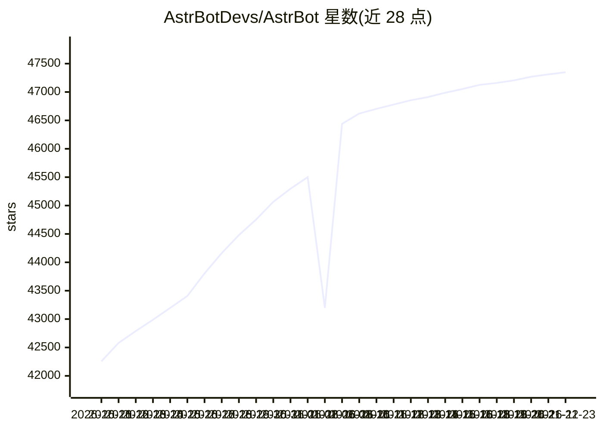

# AstrBotDevs/AstrBot

⭐ 47,348 · Python · AGPL-3.0 · 推送 2026-11-22 · [GitHub](https://github.com/AstrBotDevs/AstrBot) · [官网](https://astrbot.app) · 组织维护 · 中文 README

**面向个人/开发者/团队的 IM 平台 Agent 聊天机器人框架**

开源一体化 Agent 聊天机器人平台，接入主流即时通讯应用，为个人、开发者与团队提供对话式 AI 基础设施。核心机制包括：多平台适配层（QQ、Telegram、Slack 等 20 余平台）、多模型服务接入（LLM/语音转文字/文字转语音三类约 40 项服务）、1000+ 插件一键安装、带会话级资源复用的 Agent 沙箱、知识库与人设配置、WebUI 与 Web ChatUI 管理。部署提供 uv 一键安装、Docker、桌面应用、Launcher 及多种面板方式。

## 筛选速览

| 维度 | 判定 | 备注 |
|---|---|---|
| AI 角色 | `ai-ecosystem` | LLM/agent 周边工具 |
| 许可风险 | `viral` | AGPL-3.0 |
| 部署形态 | `self-host` | docker 或自建部署 |
| 模型依赖 | local-ok | 支持本地模型 |
| 硬件要求 | — | 无带数字的原话,不猜 |
| 安装摩擦 | `low` | 无编译、无系统依赖或容器化 |
| 成熟度 | — | 结构信号不足 |

## 动量与使用信号

- 维护:`active` — 距上次 push 0.9 天,年发版 100,374 位贡献者
- 涨星:近 1 天 **+83**(自 20261016 起算)
- 安装:pypi 包 `pre-commit` 月下载 145,624,945
- 平台:— · 协议:MCP / OLLAMA

## 能力要点

- 接入 QQ、Telegram、Slack 等 20 余个消息平台（官方/社区维护）
- 支持约 40 项模型服务：LLM、STT（Whisper/SenseVoice）、TTS（Edge TTS 等）
- 1000+ 插件生态，一键安装扩展
- Agent 沙箱：隔离执行代码与 shell 调用，会话级资源复用

## 适用场景

- 在 QQ/微信/Telegram 等 IM 里搭建个人 AI 伴侣或客服机器人
- 对接 Dify、阿里云百炼、Coze 等 agent 平台
- 通过 WebUI 与 ChatUI 管理和调试对话应用
- 用插件机制扩展企业知识库问答

## 场景标签

`聊天机器人` · 领域:对话与助手

## 证据(README 行号)

> L24: AstrBot is an open-source all-in-one Agent chatbot platform that integrates with mainstream instant messaging apps.
> L31: 2. ✨ AI LLM Conversations, Multimodal, Agent, MCP, Skills, Knowledge Base, Persona Settings, Auto Context Compressi

## 星数曲线

2026-10-21 42,256 → 2026-11-23 47,348（+5,092）

---
*卡片 v1 · prompt 1.4 · 生成 2026-11-22 · 置信度 mid · 依据 README sha `f5f6d0def7b5` · [字段定义](../../DATASET.md)*
