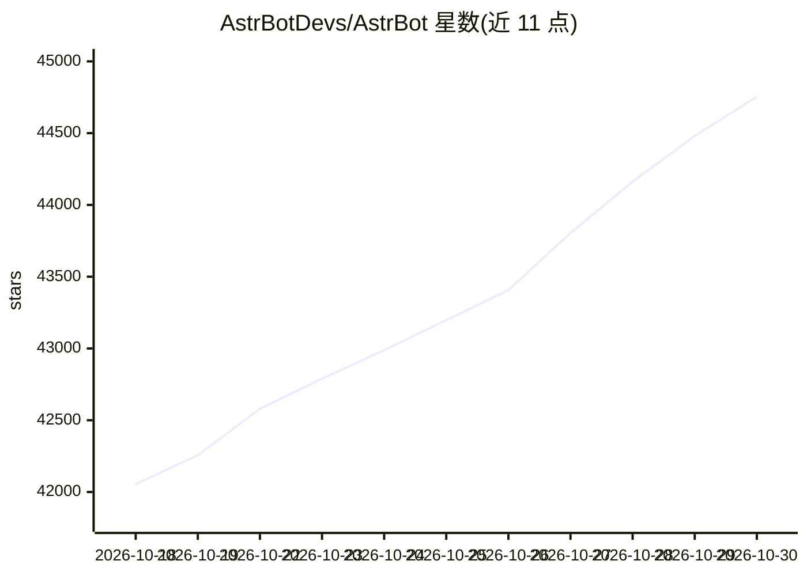

# AstrBotDevs/AstrBot

⭐ 44,754 · Python · AGPL-3.0 · 推送 2026-10-29 · [GitHub](https://github.com/AstrBotDevs/AstrBot) · [官网](https://astrbot.app) · 组织维护 · 中文 README

**对接多家 IM 平台与 LLM 的开源 Agent 聊天机器人平台**

AstrBot 是一个开源的一体化 Agent 聊天机器人平台，接入 QQ、微信企业版、飞书、钉钉、Telegram、Slack、Discord 等 20 个即时通讯平台，提供 LLM 对话、多模态、MCP、知识库、人设、自动上下文压缩等能力，并以插件机制扩展（README 称有 1000+ 插件可一键安装）。支持 Dify、阿里云百炼、Coze 等 agent 平台接入，Agent Sandbox 提供代码与 shell 的隔离执行。部署途径包括 uv、Docker、桌面应用、启动器及宝塔/1Panel/CasaOS 等。

## 筛选速览

| 维度 | 判定 | 备注 |
|---|---|---|
| AI 角色 | `ai-native` | 本体是模型或模型工具 |
| 许可风险 | `viral` | AGPL-3.0 |
| 部署形态 | `self-host` | docker 或自建部署 |
| 模型依赖 | local-ok | 支持本地模型 |
| 硬件要求 | — | 无带数字的原话,不猜 |
| 安装摩擦 | `low` | 无编译、无系统依赖或容器化 |
| 成熟度 | — | 结构信号不足 |

## 动量与使用信号

- 维护:`active` — 距上次 push 0.9 天,年发版 100,374 位贡献者
- 涨星:近 1 天 **+83**(自 20261016 起算)
- 安装:pypi 包 `pre-commit` 月下载 145,624,945
- 平台:— · 协议:MCP / OLLAMA

## 能力要点

- 接入 20 个 IM 平台（QQ、Telegram、Discord、飞书、钉钉等），官方/社区维护
- 支持多家 LLM 服务与 API 网关，含 Ollama、LM Studio 自托管
- 1000+ 插件一键安装的插件扩展机制（README 自述）
- Agent Sandbox 隔离执行代码与 shell 调用

## 适用场景

- 在 QQ/微信/Telegram 等 IM 里搭一个 AI 助手或智能客服
- 构建企业知识库问答机器人
- 通过插件扩展定制自己的聊天机器人功能

## 场景标签

`聊天机器人` `文档问答` · 领域:对话与助手

## 证据(README 行号)

> L24: AstrBot is an open-source all-in-one Agent chatbot platform that integrates with mainstream instant messaging apps.
> L33: 4. 🌐 Multi-Platform: QQ, WeChat Work, Feishu, DingTalk, WeChat Official Accounts, Telegram, Slack, and more.
> L127: |OpenAI and Compatible Services|LLM Services|

## 星数曲线

2026-10-18 42,055 → 2026-10-30 44,754（+2,699）

---
*卡片 v1 · prompt 1.4 · 生成 2026-10-18 · 置信度 mid · 依据 README sha `5faaf4f9b04e` · [字段定义](../../DATASET.md)*
