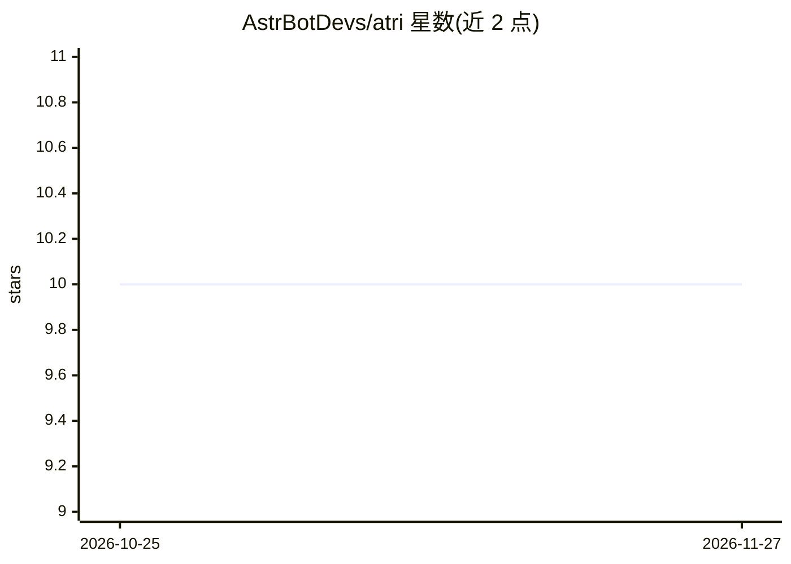

# AstrBotDevs/atri

⭐ 10 · Python · AGPL-3.0 · 推送 2026-01-24 · [GitHub](https://github.com/AstrBotDevs/atri) · [官网](https://astrbot.app) · 组织维护 · 中文 README

**为 AstrBot 提供基于图与向量检索的长期记忆模块**

ATRI 是 AstrBot（The Alkaid Project）下的记忆层组件，实现方式为图搜索、向量化语义检索，并参考认知科学设计。路线图显示已实现向量检索库与图存储库、总结/事实抽取/入图/搜索等基本功能、WebUI 可视化与记忆更新机制；记忆遗忘机制与情绪机制（关联仓库 AstrBotDevs/nova）尚未完成。README 明确声明仓库仍在建设中，不可用于生产环境；并附有基于 LongMemEval 数据集的评测准备步骤。

## 筛选速览

| 维度 | 判定 | 备注 |
|---|---|---|
| AI 角色 | `ai-ecosystem` | LLM/agent 周边工具 |
| 许可风险 | `viral` | AGPL-3.0 |
| 部署形态 | `library` | 以包/库形式分发 |
| 模型依赖 | — | README 未给出锁定关系 |
| 硬件要求 | — | 无带数字的原话,不猜 |
| 安装摩擦 | `low` | 无编译、无系统依赖或容器化 |
| 成熟度 | `idea` | |

## 能力要点

- 基于图搜索与向量化语义检索的记忆模块
- 支持总结、事实抽取、入图与搜索等基本功能
- 提供 WebUI 可视化与记忆更新机制
- 使用 LongMemEval 数据集进行评测

## 适用场景

- 为 AstrBot 接入长期记忆能力
- 对长程记忆效果做 LongMemEval 基准评测
- 通过 WebUI 查看记忆图结构

## 场景标签

`Agent 记忆` `模型评测` · 领域:Agent 开发

## 证据(README 行号)

> L5: 一个基于图搜索、向量化语义检索和认知科学的记忆模块。
> L14: - [x] 总结、事实抽取、入图、搜索等基本功能实现

## 星数曲线

2026-10-25 10 → 2026-11-27 10（+0）

---
*卡片 v1 · prompt 1.4 · 生成 2026-11-20 · 置信度 low · 依据 README sha `37e176933c99` · [字段定义](../../DATASET.md)*
