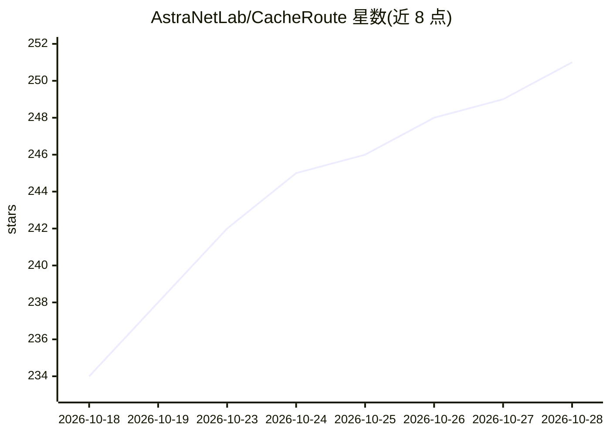

# AstraNetLab/CacheRoute

⭐ 251 · Python · Apache-2.0 · 推送 2026-08-10 · [GitHub](https://github.com/AstraNetLab/CacheRoute) · 组织维护

**面向知识密集型 LLM 服务的 KV 缓存复用调度框架**

构建于 vLLM 与 LMCache 之上的 LLM 调度框架，解决知识密集型服务（如浏览器 AI、知识问答）中重复知识前缀导致的冗余 prefill 计算：以专用 KDN 服务器存储热门知识的 KVCache 块，Proxy 按任务队列、计算与网络负载在文本注入与 KVCache 注入之间动态选择，Scheduler 结合知识可用性与拓扑做跨系统路由。组件含 Scheduler、Proxy、Instance、KDN Server 与浏览器仪表盘，提供轻量 mock demo 与基于 Docker/Redis/多 GPU 的完整部署两种路径。

## 筛选速览

| 维度 | 判定 | 备注 |
|---|---|---|
| AI 角色 | `ai-ecosystem` | LLM/agent 周边工具 |
| 许可风险 | `permissive` | Apache-2.0 |
| 部署形态 | `self-host` | docker 或自建部署 |
| 模型依赖 | local-ok | 支持本地模型 |
| 硬件要求 | — | 无带数字的原话,不猜 |
| 安装摩擦 | `low` | 无编译、无系统依赖或容器化 |
| 成熟度 | — | 结构信号不足 |

## 能力要点

- 按实时负载在文本重算与 KVCache 注入间动态选择注入策略
- KDN 服务器注册/存储/查询/注入可复用知识的 KVCache 块
- Scheduler 结合知识可用性、系统负载与拓扑做跨系统请求路由
- Proxy 浏览器可观测仪表盘与 Instance 资源仪表盘

## 适用场景

- 知识问答类 LLM 服务减少重复知识的前缀重算开销
- 多个 LLM 系统间共享热门知识的 KV 缓存
- 在计算与网络资源之间调度知识注入以降低任务延迟

## 场景标签

`推理引擎` · 领域:训练与推理

## 证据(README 行号)

> L35: CacheRoute is a lightweight LLM scheduling framework built on vLLM and LMCache to enable flexible KV cache reuse ac
> L66: - **Instance:** connects CacheRoute to vLLM + LMCache, reports a deterministic capability identity, and handles exe

## 星数曲线

2026-10-18 234 → 2026-10-28 251（+17）

---
*卡片 v1 · prompt 1.4 · 生成 2026-10-22 · 置信度 high · 依据 README sha `899b217789cf` · [字段定义](../../DATASET.md)*
