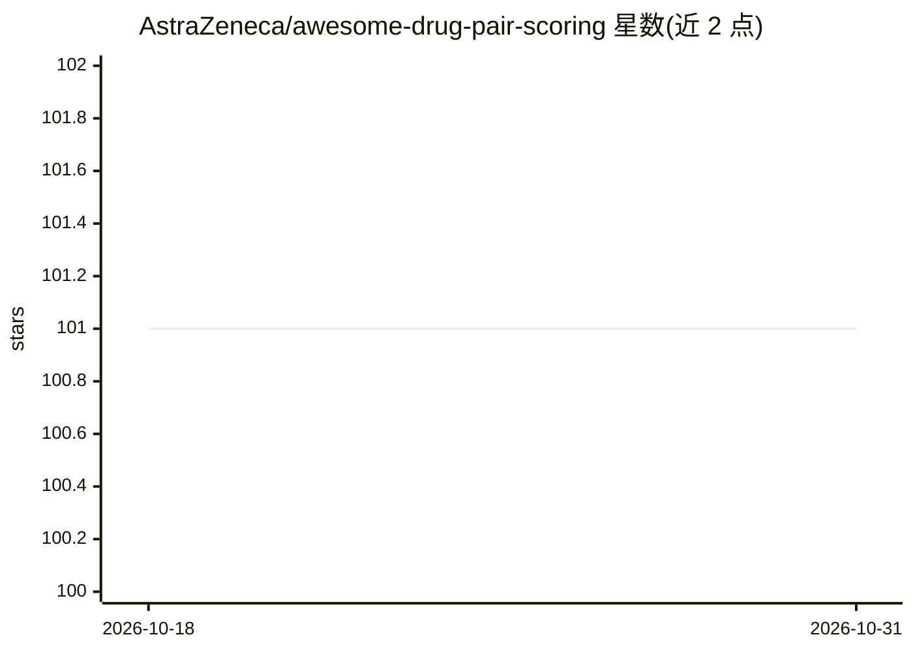

# AstraZeneca/awesome-drug-pair-scoring

⭐ 101 · Apache-2.0 · 推送 2026-10-06 · [GitHub](https://github.com/AstraZeneca/awesome-drug-pair-scoring) · 组织维护

**药物对评分关系深度学习综述的配套论文阅读清单**

AstraZeneca 团队维护的 awesome 清单，作为 IJCAI 2022 综述论文《A Unified View of Relational Deep Learning for Drug Pair Scoring》的配套仓库，收录药物对评分相关主题的阅读材料，覆盖药物-药物相互作用、药物组合、药物协同、药物重定位、药物-靶点相互作用等方向。仓库自标成熟度为 level-0，README 接受 PR 补充条目，并提供论文的 BibTeX 引用信息。面向从事药物发现与关系深度学习研究的科研人员。

## 筛选速览

| 维度 | 判定 | 备注 |
|---|---|---|
| AI 角色 | `ai-knowledge` | 知识聚合/清单类 |
| 许可风险 | `permissive` | Apache-2.0 |
| 部署形态 | `None` |  |
| 模型依赖 | — | README 未给出锁定关系 |
| 硬件要求 | — | 无带数字的原话,不猜 |
| 安装摩擦 | `low` | 无编译、无系统依赖或容器化 |
| 成熟度 | `idea` | |

## 能力要点

- IJCAI 2022 综述论文的官方配套仓库
- 主题覆盖 DDI、药物组合/协同、药物重定位、药物-靶点相互作用
- 以 awesome 清单形式组织，接受 PR 贡献

## 适用场景

- 按主题查找药物对评分方向的论文阅读材料
- 引用综述论文时获取配套代码与资源入口

## 场景标签

`精选清单` `科研工具` · 领域:学习与行业

## 证据(README 行号)

> L8: This repository accompanies our survey paper A Unified View of Relational Deep Learning for Drug Pair Scoring.
> L1: # Awesome Drug Pair Scoring

## 星数曲线

2026-10-18 101 → 2026-10-31 101（+0）

---
*卡片 v1 · prompt 1.4 · 生成 2026-10-23 · 置信度 high · 依据 README sha `1d62a498ac6e` · [字段定义](../../DATASET.md)*
