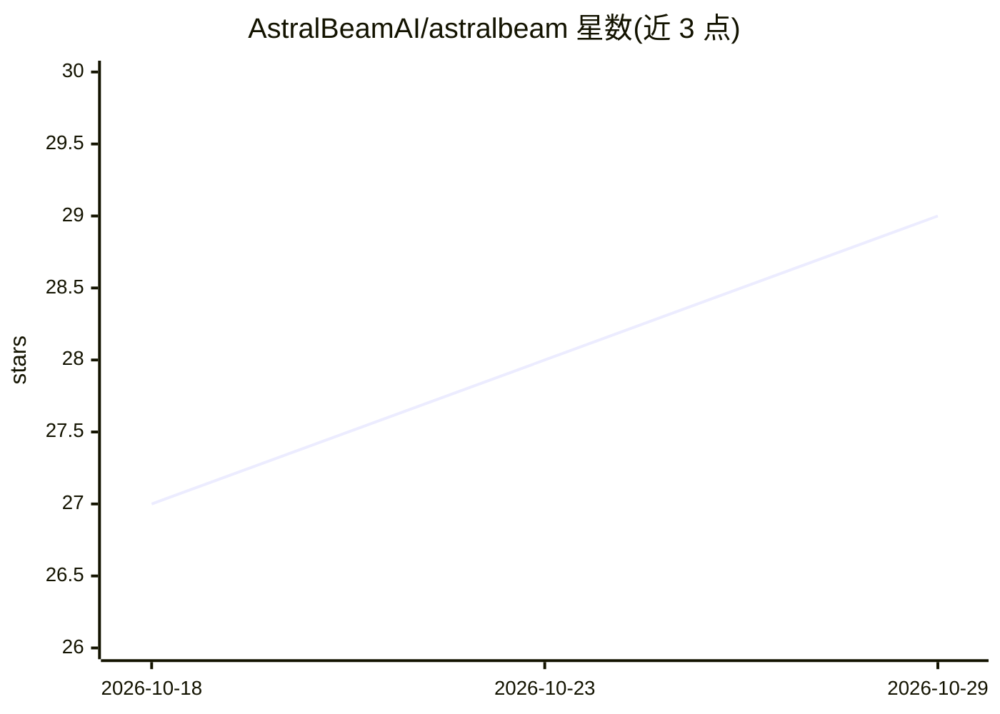

# AstralBeamAI/astralbeam

⭐ 29 · TypeScript · AGPL-3.0 · 推送 2026-10-28 · [GitHub](https://github.com/AstralBeamAI/astralbeam) · [官网](https://astralbeam.ai) · 组织维护

**嵌入式 AI agent SDK：给 Web 应用添加 Cursor 风格助手**

面向应用开发者的开源 agent 方案：将可对话的 AI agent 嵌入自有应用，支持回答查询、与应用交互、渲染应用自身的 UI 组件以及处理用户文件；提供自托管部署，或使用 AstralBeam Cloud 托管服务。README 附带嵌入了该 agent 的 Linear 克隆演示，仓库按目录拆分许可（MIT 与 AGPL-3.0-only），公司主体 AstralBeam Inc. 维护。可见 README 未给出详细安装步骤，仅含 npm 徽标。

## 筛选速览

| 维度 | 判定 | 备注 |
|---|---|---|
| AI 角色 | `ai-ecosystem` | LLM/agent 周边工具 |
| 许可风险 | `viral` | AGPL-3.0 |
| 部署形态 | `None` |  |
| 模型依赖 | — | README 未给出锁定关系 |
| 硬件要求 | — | 无带数字的原话,不猜 |
| 安装摩擦 | `low` | 无编译、无系统依赖或容器化 |
| 成熟度 | — | 结构信号不足 |

## 能力要点

- 将 Cursor 风格 agent 嵌入自有应用
- agent 可渲染应用自身 UI 组件并处理用户文件
- 支持自托管或 AstralBeam Cloud

## 适用场景

- 给自己的 Web 应用添加能操作应用内功能的 AI 助手
- 自托管部署面向用户的应用内 agent

## 场景标签

`Agent 框架` · 领域:Agent 开发

## 证据(README 行号)

> L7: AstralBeam adds a Cursor-style AI agent to your app in minutes. It answers queries, interacts with your app, renders
> L13: Start with local setup, then see contributing for project structure and validation or architecture for implementati

## 星数曲线

2026-10-18 27 → 2026-10-29 29（+2）

---
*卡片 v1 · prompt 1.4 · 生成 2026-10-26 · 置信度 mid · 依据 README sha `7bed19efe62c` · [字段定义](../../DATASET.md)*
