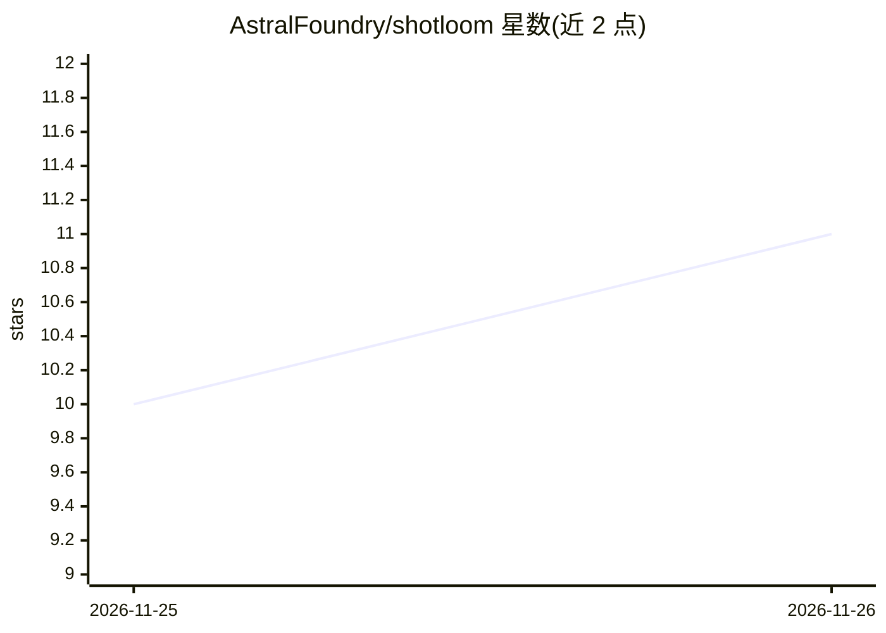

# AstralFoundry/shotloom

⭐ 11 · TypeScript · MIT · 推送 2026-11-24 · [GitHub](https://github.com/AstralFoundry/shotloom) · 组织维护 · 中文 README

**给影像创作者的 AI 桌面工作台：画布+生成+3D 预演+剪辑**

面向 AI 影像创作的桌面应用，将无限画布、文本/图片/视频/音频生成、3D 世界引擎预演与基于 OpenReel 的多轨视频剪辑放在同一项目中。分镜脚本把剧情拆成逐镜提示词并批量生成，批量创作表支持行级参考与并发任务。生成能力通过厂商插件接入，用户自带 API Key；无模型时画布与世界引擎仍可使用。提供 macOS/Windows 安装包，源码需 Node.js ≥ 22.19.0。

## 筛选速览

| 维度 | 判定 | 备注 |
|---|---|---|
| AI 角色 | `ai-native` | 本体是模型或模型工具 |
| 许可风险 | `permissive` | MIT |
| 部署形态 | `None` |  |
| 模型依赖 | — | README 未给出锁定关系 |
| 硬件要求 | — | 无带数字的原话,不猜 |
| 安装摩擦 | `low` | 无编译、无系统依赖或容器化 |
| 成熟度 | — | 结构信号不足 |

## 能力要点

- 无限画布组织文本、图片、视频、音频素材与生成节点
- 分镜脚本与批量创作表逐镜生成图片/视频
- 世界引擎 3D 预演，白膜/深度/法线视图与生成模型对位
- 插件机制接入各厂商生成模型，自带 API Key

## 适用场景

- 在一张画布上推进剧本、分镜、生成与剪辑的全流程
- 用批量创作表为多组参考图批量生成镜头素材
- 用世界引擎先预演构图运镜再生成
- 整理角色与场景素材并在项目间复用

## 场景标签

`图像生成` `视频生成` · 领域:内容生成

## 证据(README 行号)

> L8: Shotloom 是面向 AI 影像创作的桌面工作台，将无限画布、AI 生成、3D 预演和视频剪辑放在同一个项目中。把参考素材和创作思路连起来，与 Agent 一起推进剧本、分镜和制作。
> L74: Shotloom 通过厂商插件接入 AI 服务。一个插件可以同时提供生成模型和画布工具，共用连接与 API Key。插件支持通过 npm、本地文件或 URL 安装，也可以在插件中心启用、停用或卸载。
> L93: 从 Releases 下载 macOS Apple Silicon 或 Windows x64 安装包。

## 星数曲线

2026-11-25 10 → 2026-11-26 11（+1）

---
*卡片 v1 · prompt 1.4 · 生成 2026-11-24 · 置信度 high · 依据 README sha `054ad9cbbb53` · [字段定义](../../DATASET.md)*
