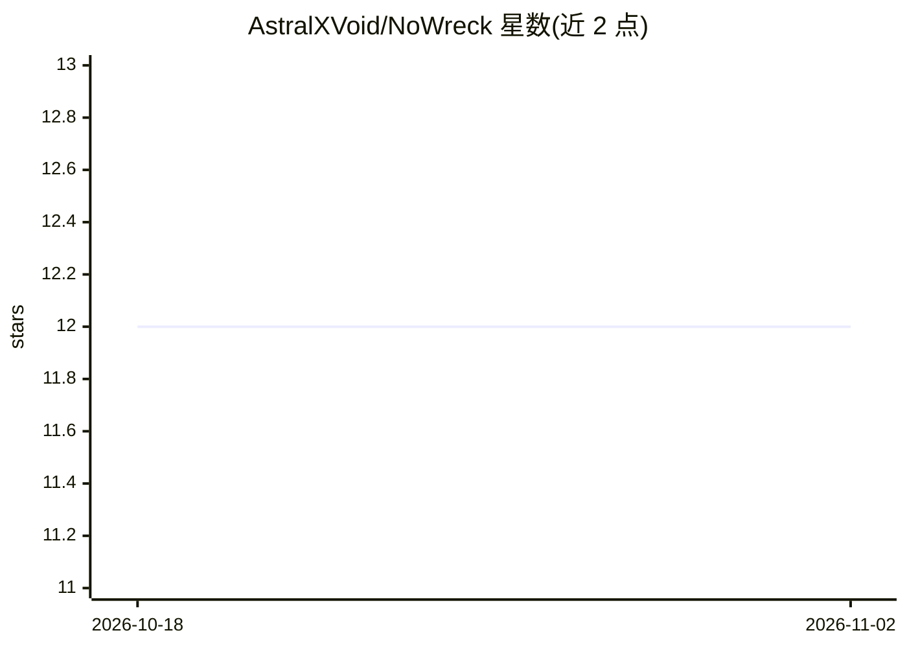

# AstralXVoid/NoWreck

⭐ 12 · Python · NOASSERTION · 推送 2026-10-13 · [GitHub](https://github.com/AstralXVoid/NoWreck) · 个人维护

**CLI 工具：核验 AI 代码变更声明与实际结构改动是否一致**

面向使用 AI 编码助手的开发者的确定性结构验证器：对比 AI 声称的代码变更与扫描器从仓库快照（或模型提出的 diff）提取的结构证据，捕捉幻觉函数、虚假调用、说明与 diff 不符及未声明的改动。三种模式：Prompt Mode 调用配置模型生成 diff 并独立验证；Pre/Post 与 Claims Mode 扫描前后快照，无需 API key 可离线运行。决策阶段不使用 AI 判断，遵循显式结构规则；明确声明不做代码质量、安全或语义正确性判定。Python 3.11+，PyPI 安装。

## 筛选速览

| 维度 | 判定 | 备注 |
|---|---|---|
| AI 角色 | `ai-ecosystem` | LLM/agent 周边工具 |
| 许可风险 | `none` | NOASSERTION |
| 部署形态 | `library` | 以包/库形式分发 |
| 模型依赖 | local-ok | 支持本地模型 |
| 硬件要求 | — | 无带数字的原话,不猜 |
| 安装摩擦 | `low` | 无编译、无系统依赖或容器化 |
| 成熟度 | — | 结构信号不足 |

## 能力要点

- 捕捉幻觉函数/类、虚假内部调用、说明与 diff 不符、未声明改动
- 决策阶段确定性规则比对，不以模型输出作为验证同一声明的证据
- Pre/Post 与 Claims 模式可完全离线运行，无需 API key
- 兼容 OpenAI/Anthropic/Gemini/Groq/Ollama 等多种提供方并自动检测 base_url

## 适用场景

- 在 CI/CD 中核验 AI 助手的变更说明是否与实际 diff 一致
- 开发时手动比对前后快照、发现未被说明的改动
- 验证外部来源（其他 AI 或人工）提交的结构化 claims

## 场景标签

 · 领域:AI 编码验证工具

## 证据(README 行号)

> L7:  NoWreck is a deterministic structural verifier for AI-generated code-change
> L44: **The verifier uses no AI judgment.** The decision stage never asks an AI

## 星数曲线

2026-10-18 12 → 2026-11-02 12（+0）

---
*卡片 v1 · prompt 1.4 · 生成 2026-11-01 · 置信度 high · 依据 README sha `4ea5feb193b8` · [字段定义](../../DATASET.md)*
