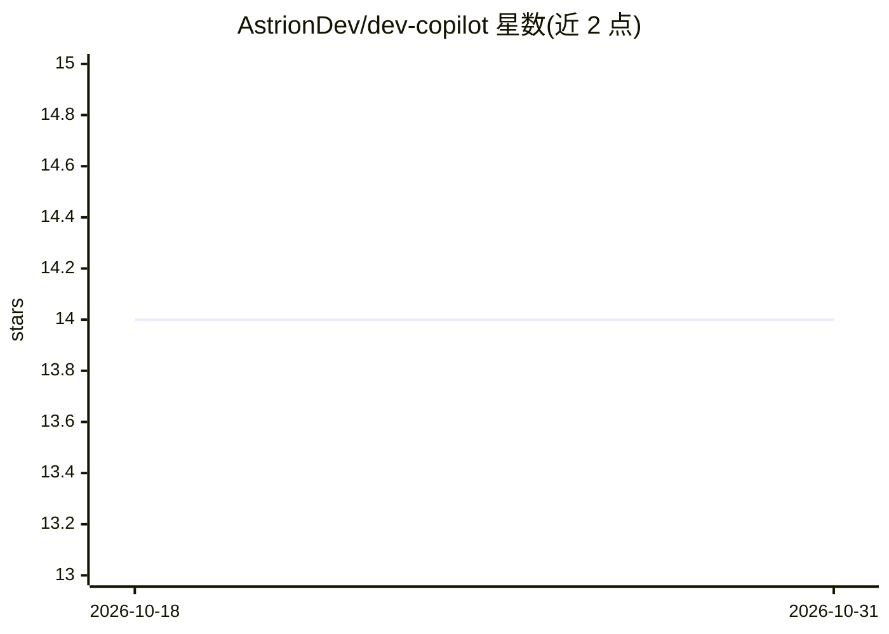

# AstrionDev/dev-copilot

⭐ 14 · Python · 推送 2026-01-21 · [GitHub](https://github.com/AstrionDev/dev-copilot) · 个人维护

**面向开发者的技术问答 agent，检索网页与文档后给出带来源回答**

CLI 形式的开发者问答 chatbot agent，基于 LangChain（可选 LangGraph 引擎）。回答技术问题时调用 DuckDuckGo 搜索、StackOverflow（StackExchange API）搜索、官方文档偏向搜索与网页抓取，输出含 Sources 的 JSON 回答，来源列表过滤为实际抓取过的 URL。检索前设有人工审批环节，可用 --no-approval 关闭。默认对接本地 OpenAI 兼容端点（LM Studio，默认模型 qwen/qwen-3-1.7b），自述为作品集演示项目，网页解析与输出质量依赖外部网络与本地模型。

## 筛选速览

| 维度 | 判定 | 备注 |
|---|---|---|
| AI 角色 | `ai-native` | 本体是模型或模型工具 |
| 许可风险 | `none` | — |
| 部署形态 | `None` |  |
| 模型依赖 | — | README 未给出锁定关系 |
| 硬件要求 | — | 无带数字的原话,不猜 |
| 安装摩擦 | `low` | 无编译、无系统依赖或容器化 |
| 成熟度 | — | 结构信号不足 |

## 能力要点

- DuckDuckGo / StackOverflow / 文档偏向搜索与网页抓取工具链
- 引用必须来自实际抓取的 URL，来源列表做过滤
- 研究前人工审批门控（--no-approval 可跳过）
- 默认对接本地 OpenAI 兼容端点（LM Studio + qwen/qwen-3-1.7b）

## 适用场景

- 在命令行提问技术问题并获得带来源引用的回答
- 查看 agent 如何组合搜索、抓取与人工审批完成技术研究
- 作为本地模型驱动的 agentic research 演示项目

## 场景标签

`聊天机器人` · 领域:对话与助手

## 证据(README 行号)

> L6: A developer-focused chatbot agent that answers technical questions using:
> L49: |`LM_STUDIO_BASE_URL`|`http://localhost:1234/v1`|Local OpenAI-compatible endpoint|

## 星数曲线

2026-10-18 14 → 2026-10-31 14（+0）

---
*卡片 v1 · prompt 1.4 · 生成 2026-10-31 · 置信度 high · 依据 README sha `6d02bb558a12` · [字段定义](../../DATASET.md)*
