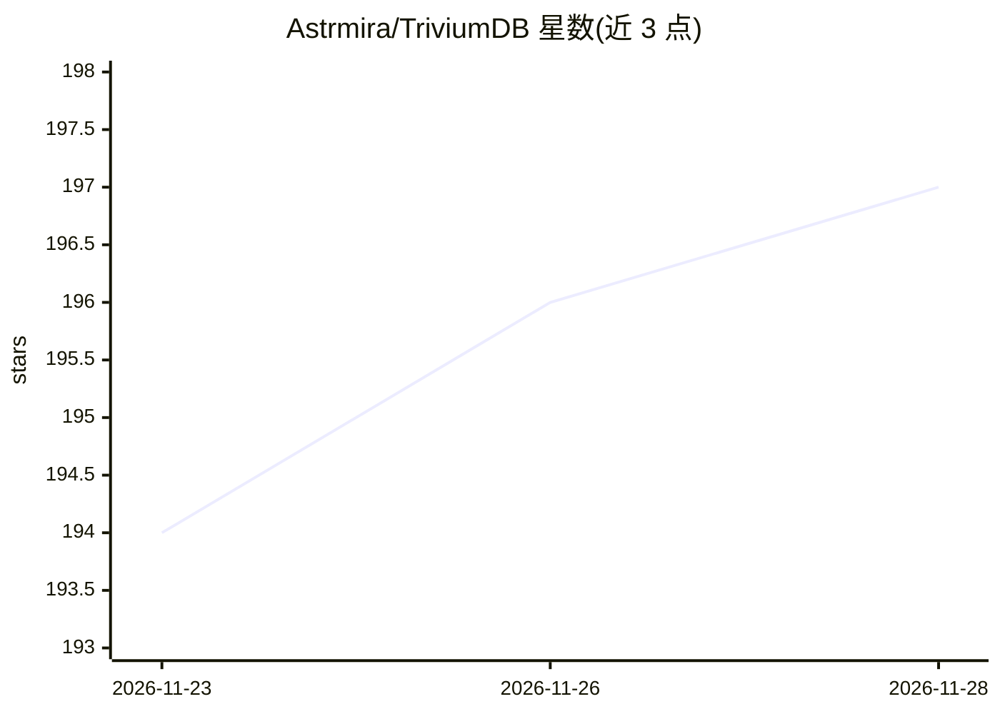

# Astrmira/TriviumDB

⭐ 197 · Rust · Apache-2.0 · 推送 2026-11-24 · [GitHub](https://github.com/Astrmira/TriviumDB) · [官网](https://triviumdb.com) · 个人维护 · 中文 README

**面向 Agent/RAG 的嵌入式向量-图-文档三模数据库**

用 Rust 编写的进程内嵌入式数据库引擎，在单一存储内核中同时提供向量检索、属性图谱与 JSON 文档存储，每个节点可同时携带向量、稀疏文本、元数据与图关系。提供 TQL 查询语言（向量召回、图扩展、属性过滤、集合代数等算子可编排）、四类持久化属性索引、内嵌图算法库、WAL 与快照备份。通过 Rust/Python/Node.js SDK 使用，预编译分发无需本地编译环境；另有 nightly 状态的 HTTP 服务端壳，官方定位仍为嵌入式数据库。面向构建 Agent 记忆、RAG 与知识图谱应用的开发者。

## 筛选速览

| 维度 | 判定 | 备注 |
|---|---|---|
| AI 角色 | `ai-ecosystem` | LLM/agent 周边工具 |
| 许可风险 | `permissive` | Apache-2.0 |
| 部署形态 | `library` | 以包/库形式分发 |
| 模型依赖 | — | README 未给出锁定关系 |
| 硬件要求 | — | 无带数字的原话,不猜 |
| 安装摩擦 | `low` | 无编译、无系统依赖或容器化 |
| 成熟度 | `idea` | |

## 能力要点

- 单内核原生融合向量、属性图谱与文档元数据，节点通过全局 NodeId 关联
- TQL 查询语言支持向量召回、图扩展、BM25/AC 文本召回与集合代数的自由编排
- 自研 QuIVer ANN 索引（BQ 构图 + SM-L2 导航 + 余弦精排），另有双曲向量索引 Pelorus
- 多实例 ResourceRuntime 管理配额、线程与快照，支持只读多进程共享

## 适用场景

- 为 AI Agent 存储长期对话记忆并沿关系链扩散召回
- 个人知识库的语义搜索与知识图谱导航
- RAG 应用的向量召回加图上下文扩展
- 小型推荐系统的混合检索

## 场景标签

`向量数据库` `Agent 记忆` `知识图谱` · 领域:Agent 开发

## 证据(README 行号)

> L15: > TriviumDB 为 Agent、RAG 和知识图谱应用提供进程内的向量、图与文档存储。宿主应用通过 Rust、Python 或 Node.js API 管理数据库实例、查询和持久化。
> L36: 我们的目标是成为 **AI 应用领域的 SQLite**：
> L85: |🤖 **AI Agent 长期记忆**|每条对话存为节点（embedding + 原文 + 时间戳），人物/地点/事件之间建边，召回时先向量匹配再沿关系链扩散|

## 星数曲线

2026-11-23 194 → 2026-11-28 197（+3）

---
*卡片 v1 · prompt 1.4 · 生成 2026-11-26 · 置信度 high · 依据 README sha `3a9463b3323e` · [字段定义](../../DATASET.md)*
