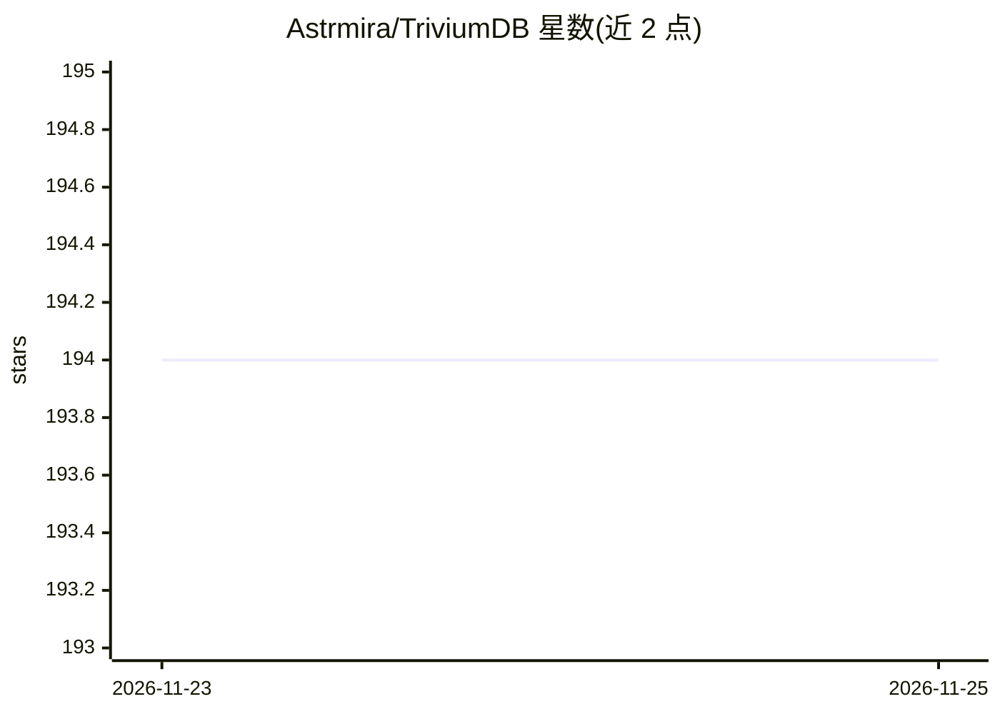

# Astrmira/TriviumDB

⭐ 194 · Rust · Apache-2.0 · 推送 2026-11-22 · [GitHub](https://github.com/Astrmira/TriviumDB) · [官网](https://triviumdb.com) · 组织维护 · 中文 README

**面向 Agent/RAG 应用的向量×图×文档嵌入式数据库**

用 Rust 编写的进程内嵌入式数据库引擎，在单一存储内核中融合向量检索、属性图谱与 JSON 文档存储，每个节点同时携带向量、稀疏文本、元数据与图关系。通过 TQL 查询语言编排向量召回、图扩展、文本与认知算子，内置自研 ANN 索引 QuIVer 与双曲索引 Pelorus，提供 Python、Node.js、Rust 三语言 SDK 与预编译安装包，另有 nightly 状态的 HTTP 服务端壳。定位为 AI 应用（Agent 记忆、RAG、知识图谱）的本地存储层。当前版本为 0.9.4-beta 预发布。

## 筛选速览

| 维度 | 判定 | 备注 |
|---|---|---|
| AI 角色 | `ai-ecosystem` | LLM/agent 周边工具 |
| 许可风险 | `permissive` | Apache-2.0 |
| 部署形态 | `library` | 以包/库形式分发 |
| 模型依赖 | — | README 未给出锁定关系 |
| 硬件要求 | — | 无带数字的原话,不猜 |
| 安装摩擦 | `low` | 无编译、无系统依赖或容器化 |
| 成熟度 | `idea` | |

## 能力要点

- 单内核同时存储向量、图谱与文档，节点通过全局 NodeId 关联
- TQL 查询语言可编排向量召回、属性索引、图扩展与图算法
- 自研 ANN 索引 QuIVer，维度上限 3072，小规模走精确 BruteForce
- pip/npm/cargo 三语言预编译安装，无需本地编译环境

## 适用场景

- 给 AI Agent 存对话记忆，召回时向量匹配后沿关系链扩散
- Markdown 笔记入库后做语义搜索加知识图谱导航
- RAG 管线里一步完成向量、文本与图结构混合检索
- 游戏 NPC 把观察到的事件存为带向量节点做记忆检索

## 场景标签

`Agent 记忆` `知识图谱` `RAG` `向量数据库` · 领域:Agent 开发

## 证据(README 行号)

> L15: > TriviumDB 为 Agent、RAG 和知识图谱应用提供进程内的向量、图与文档存储。宿主应用通过 Rust、Python 或 Node.js API 管理数据库实例、查询和持久化。
> L36: 我们的目标是成为 **AI 应用领域的 SQLite**：
> L85: |🤖 **AI Agent 长期记忆**|每条对话存为节点（embedding + 原文 + 时间戳），人物/地点/事件之间建边，召回时先向量匹配再沿关系链扩散|

## 星数曲线

2026-11-23 194 → 2026-11-25 194（+0）

---
*卡片 v1 · prompt 1.4 · 生成 2026-11-23 · 置信度 high · 依据 README sha `5557080a408a` · [字段定义](../../DATASET.md)*
